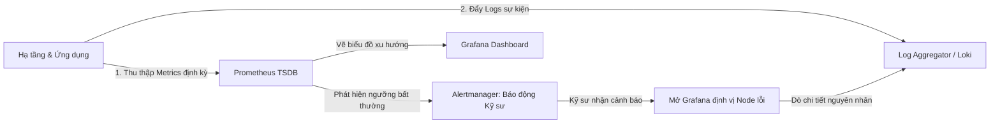
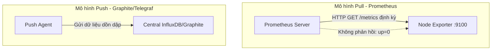
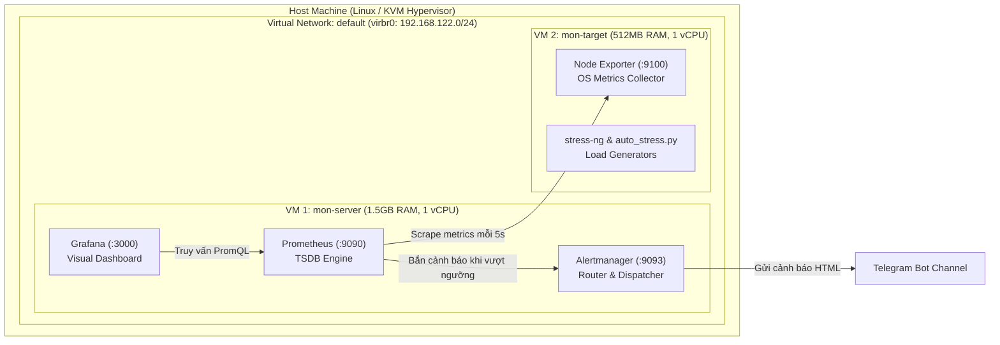
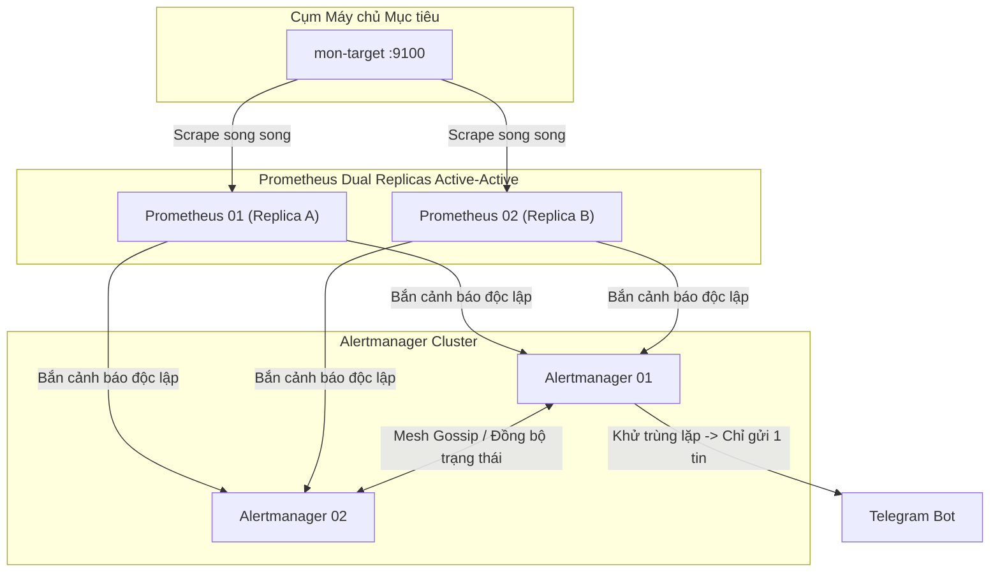
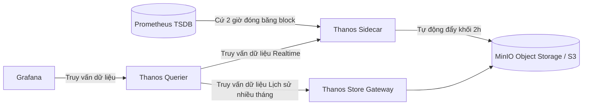
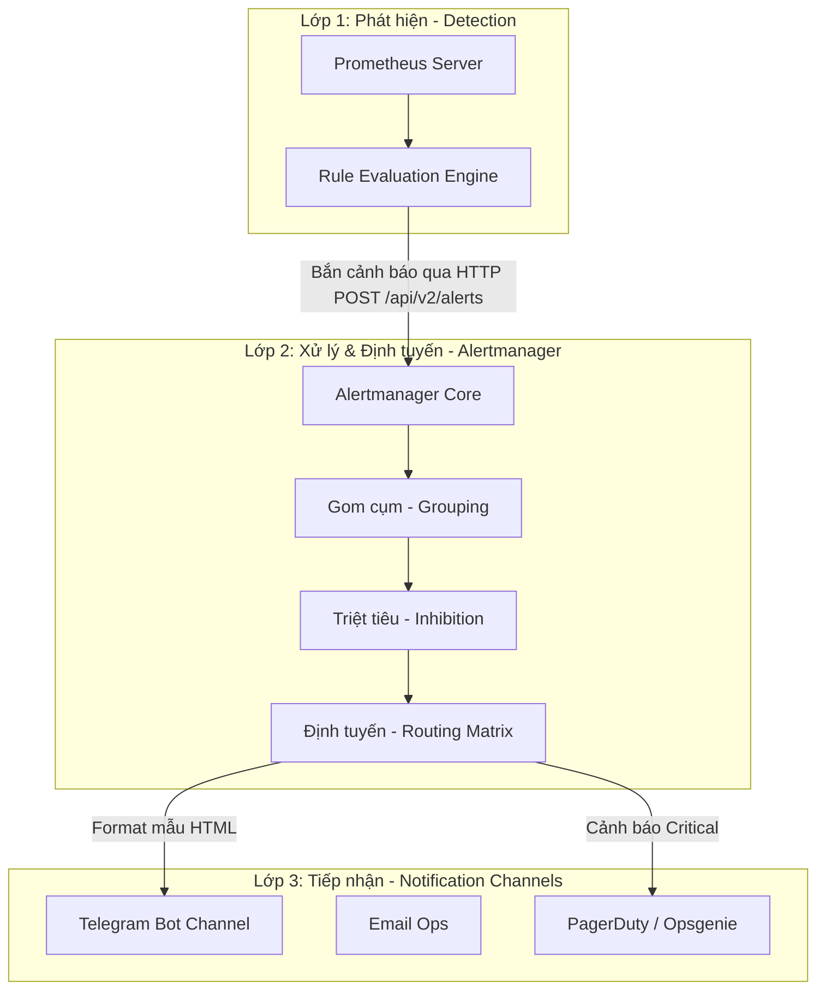
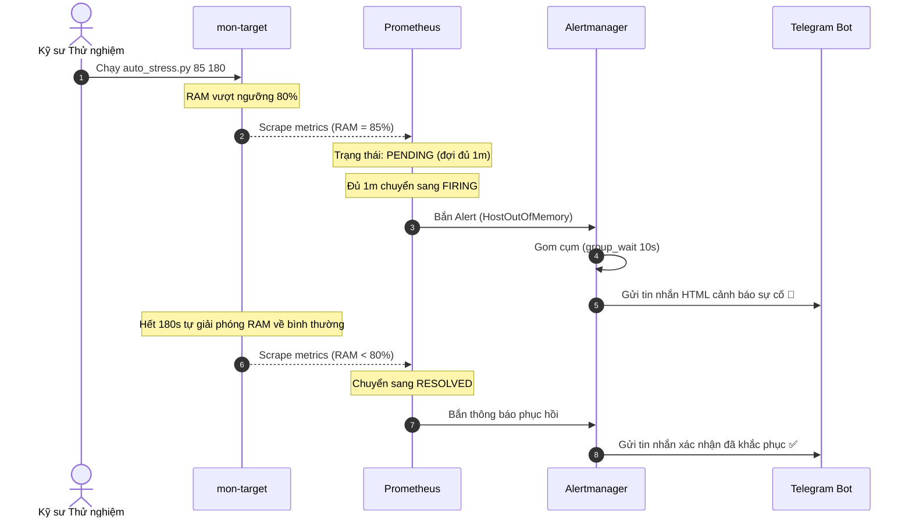
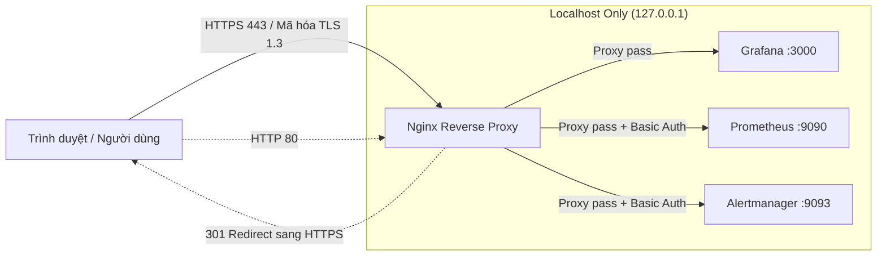
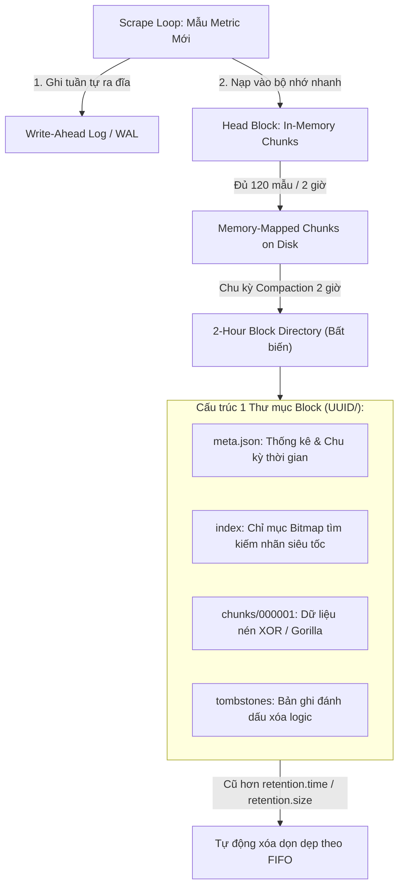
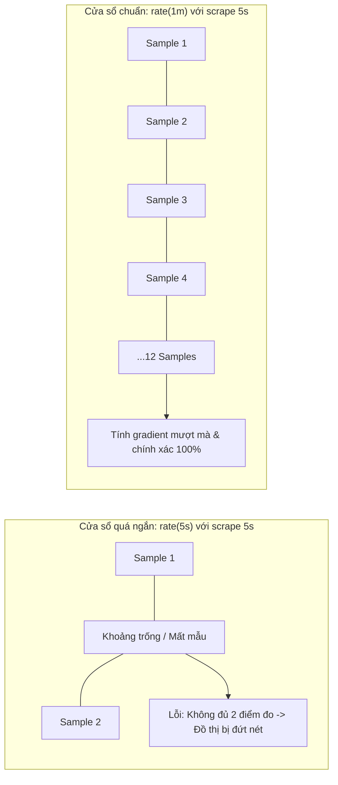

# BÁO CÁO TOÀN DIỆN VỀ HỆ THỐNG GIÁM SÁT VÀ CẢNH BÁO TỰ ĐỘNG
## Xây dựng Nền tảng Giám sát Chuẩn Production với Prometheus, Grafana, Alertmanager & Node Exporter trên Môi trường Linux
**Học phần / Chuyên đề:** Linux System Administration & Observability Engineering  
**Hạ tầng thực nghiệm:** Nền tảng KVM/libvirt Debian 12 (`mon-server` và `mon-target`)

---

# MỤC LỤC TỔNG QUAN

- [I. Overview: Brief Introduction of Monitoring and Logging, the Need of That and Why We Chose This Topic](#i-overview-brief-introduction-of-monitoring-and-logging-the-need-of-that-and-why-we-chose-this-topic)
  - [1. Khái niệm và Bối cảnh Observability (Khả năng quan sát)](#1-khái-niệm-và-bối-cảnh-observability-khả-năng-quan-sát)
  - [2. Sự cần thiết của Giám sát và Ghi log trong Vận hành Hiện đại](#2-sự-cần-thiết-của-giám-sát-và-ghi-log-trong-vận-hành-hiện-đại)
  - [3. Lý do lựa chọn Đề tài (Why We Chose This Topic)](#3-lý-do-lựa-chọn-đề-tài-why-we-chose-this-topic)
  - [4. Nền tảng Lý thuyết Cốt lõi về Prometheus & Time Series Data](#4-nền-tảng-lý-thuyết-cốt-lõi-về-prometheus--time-series-data)
- [II. Set Up the Environment](#ii-set-up-the-environment)
  - [1. Kiến trúc Mô hình Thực nghiệm Phân tán](#1-kiến-trúc-mô-hình-thực-nghiệm-phân-tán)
  - [2. Thiết lập Môi trường Host (KVM/libvirt trên Arch Linux, Fedora, VirtualBox)](#2-thiết-lập-môi-trường-host-kvmlibvirt-trên-arch-linux-fedora-virtualbox)
  - [3. Cấp phát Máy ảo Tự động bằng Cloud-Init và CoW Overlay Disk](#3-cấp-phát-máy-ảo-tự-động-bằng-cloud-init-và-cow-overlay-disk)
  - [4. Cấu hình Máy ảo Mục tiêu (Target VM - `mon-target`)](#4-cấu-hình-máy-ảo-mục-tiêu-target-vm---mon-target)
  - [5. Cài đặt và Cấu hình Máy chủ Giám sát (Monitoring Server - `mon-server`)](#5-cài-đặt-và-cấu-hình-máy-chủ-giám-sát-monitoring-server---mon-server)
  - [6. Kết nối Data Source và Trực quan hóa trên Grafana](#6-kết-nối-data-source-và-trực-quan-hóa-trên-grafana)
- [III. HA & Long-term Storage](#iii-ha--long-term-storage)
  - [1. Đặt vấn đề và Thách thức Lưu trữ của Prometheus Local TSDB](#1-đặt-vấn-đề-và-thách-thức-lưu-trữ-của-prometheus-local-tsdb)
  - [2. Chiến lược Tối ưu hóa Local Storage & Retention](#2-chiến-lược-tối-ưu-hóa-local-storage--retention)
  - [3. Kiến trúc High Availability (HA Replicas) Active-Active](#3-kiến-trúc-high-availability-ha-replicas-active-active)
  - [4. Lưu trữ Dài hạn (LTS) với Thanos Sidecar và MinIO Object Storage](#4-lưu-trữ-dài-hạn-lts-với-thanos-sidecar-và-minio-object-storage)
  - [5. Kịch bản Kiểm chứng Tính sẵn sàng và Failover](#5-kịch-bản-kiểm-chứng-tính-sẵn-sàng-và-failover)
- [IV. Production Alerting](#iv-production-alerting)
  - [1. Triết lý Vận hành và Hiện tượng "Bão cảnh báo" (Alert Fatigue)](#1-triết-lý-vận-hành-và-hiện-tượng-bão-cảnh-báo-alert-fatigue)
  - [2. Kiến trúc Cảnh báo 3 Lớp (Detection - Processing - Notification)](#2-kiến-trúc-cảnh-báo-3-lớp-detection---processing---notification)
  - [3. Quản lý Xung đột Cổng và Dịch vụ Systemd Alertmanager](#3-quản-lý-xung-đột-cổng-và-dịch-vụ-systemd-alertmanager)
  - [4. Cơ chế Nâng cao: Gom cụm (Grouping) và Triệt tiêu (Inhibition)](#4-cơ-chế-nâng-cao-gom-cụm-grouping-và-triệt-tiêu-inhibition)
  - [5. Thiết kế Mẫu thông báo Telegram HTML và Sửa lỗi Timestamp](#5-thiết-kế-mẫu-thông-báo-telegram-html-và-sửa-lỗi-timestamp)
  - [6. Chuẩn hóa Alerting Rules và Khắc phục Sai lệch Công thức RAM](#6-chuẩn-hóa-alerting-rules-và-khắc-phục-sai-lệch-công-thức-ram)
  - [7. Bộ công cụ Kiểm thử Tự động và Kịch bản Demo Thực tế](#7-bộ-công-cụ-kiểm-thử-tự-động-và-kịch-bản-demo-thực-tế)
- [V. Security and Auth](#v-security-and-auth)
  - [1. Mô hình Đe dọa An ninh (Threat Model) đối với Hệ thống Monitoring](#1-mô-hình-đe-dọa-an-ninh-threat-model-đối-với-hệ-thống-monitoring)
  - [2. Mã hóa Đường truyền Toàn diện qua TLS/HTTPS với Nginx Reverse Proxy](#2-mã-hóa-đường-truyền-toàn-diện-qua-tlshttps-với-nginx-reverse-proxy)
  - [3. Xác thực Truy cập Web Basic Auth (bcrypt) cho Prometheus và Exporter](#3-xác-thực-truy-cập-web-basic-auth-bcrypt-cho-prometheus-và-exporter)
  - [4. Kiểm soát Phân quyền (RBAC) và Siết chặt Bảo mật Grafana](#4-kiểm-soát-phân-quyền-rbac-và-siết-chặt-bảo-mật-grafana)
  - [5. Tường lửa Hạ tầng UFW và Vô hiệu hóa Endpoint Quản trị Nhạy cảm](#5-tường-lửa-hạ-tầng-ufw-và-vô-hiệu-hóa-endpoint-quản-trị-nhạy-cảm)
  - [6. Kịch bản Kiểm thử Bảo mật và Bảng Checklist Hardening](#6-kịch-bản-kiểm-thử-bảo-mật-và-bảng-checklist-hardening)
- [VI. Optimization](#vi-optimization)
  - [1. Quản lý Metric Cardinality và Kỹ thuật Relabeling](#1-quản-lý-metric-cardinality-và-kỹ-thuật-relabeling)
  - [2. Tái sử dụng kết quả truy vấn với Recording Rules](#2-tái-sử-dụng-kết-quả-truy-vấn-với-recording-rules)
  - [3. Application Performance Monitoring (APM) & Golden Signals](#3-application-performance-monitoring-apm--golden-signals)
  - [4. Tinh chỉnh Bộ máy Lưu trữ Nội tại (TSDB Engine Tuning)](#4-tinh-chỉnh-bộ-máy-lưu-trữ-nội-tại-tsdb-engine-tuning)
- [VII. GitOps, Monitoring as Code](#vii-gitops-monitoring-as-code)
  - [1. Đặt vấn đề: Thảm họa ClickOps và Triết lý Monitoring-as-Code](#1-đặt-vấn-đề-thảm-họa-clickops-và-triết-lý-monitoring-as-code)
  - [2. Khai báo Nguồn dữ liệu và Dashboard Tự động (Grafana Provisioning)](#2-khai-báo-nguồn-dữ-liệu-và-dashboard-tự-động-grafana-provisioning)
  - [3. Cấp phát Mục tiêu Giám sát Động qua File-based Service Discovery](#3-cấp-phát-mục-tiêu-giám-sát-động-qua-file-based-service-discovery)
  - [4. Xây dựng Pipeline Triển khai Tự động An toàn (`deploy_stack.sh`)](#4-xây-dựng-pipeline-triển-khai-tự-động-an-toàn-deploy_stacksh)
  - [5. Bảng So sánh Toàn diện Phương thức Vận hành ClickOps vs. GitOps](#5-bảng-so-sánh-toàn-diện-phương-thức-vận-hành-clickops-vs-gitops)

- [VIII. Phần mở rộng](#viii-phần-mở-rộng)
  - [1. Chuẩn hóa truy vấn bằng Recording Rules](#1-chuẩn-hóa-truy-vấn-bằng-recording-rules)

---

# I. Overview: Brief Introduction of Monitoring and Logging, the Need of That and Why We Chose This Topic

## 1. Khái niệm và Bối cảnh Observability (Khả năng quan sát)

Trong kỷ nguyên điện toán đám mây và kiến trúc phân tán (Microservices, Kubernetes, Multi-cloud), các hệ thống phần mềm và hạ tầng máy chủ ngày càng trở nên phức tạp. Khi một sự cố xảy ra (ví dụ: phản hồi người dùng chậm, máy chủ cạn kiệt tài nguyên, dịch vụ sập đột ngột), phương thức dò tìm lỗi truyền thống thông qua việc đăng nhập SSH vào từng máy chủ để đọc log thủ công hoàn toàn bất khả thi.

Để kiểm soát và hiểu rõ trạng thái nội tại của hệ thống từ bên ngoài, khái niệm **Observability (Khả năng quan sát)** được hình thành dựa trên 3 trụ cột (The Three Pillars of Observability):
1. **Metrics (Số liệu đo lường theo chuỗi thời gian):** Các giá trị số thể hiện hành vi tài nguyên và ứng dụng theo thời gian (ví dụ: % sử dụng CPU, dung lượng RAM khả dụng, số lượng request/giây, độ trễ 99th percentile). Metrics có đặc điểm là nhỏ gọn, cấu trúc chuẩn hóa, chi phí lưu trữ thấp và cực kỳ tối ưu cho việc vẽ biểu đồ xu hướng (Dashboards) và kích hoạt cảnh báo tự động (Alerting).
2. **Logs (Nhật ký sự kiện):** Các bản ghi văn bản (text hoặc JSON) chứa thông điệp chi tiết về một sự kiện cụ thể đã xảy ra tại một thời điểm nhất định (ví dụ: traceback ngoại lệ trong mã nguồn, nhật ký truy cập HTTP 404/500, nhật ký kernel OOM-killer). Logs giúp kỹ sư trả lời câu hỏi *"Chuyện gì chính xác đã xảy ra tại thời điểm đó?"*.
3. **Traces (Dấu vết phân tán):** Theo dõi đường đi của một yêu cầu (request lifecycle) xuyên suốt qua hàng chục dịch vụ vi mô khác nhau để định vị điểm nghẽn độ trễ.

### So sánh cốt lõi: Monitoring vs. Logging

| Tiêu chí | Metrics (Monitoring) | Logs (Logging) |
| :--- | :--- | :--- |
| **Bản chất dữ liệu** | Dữ liệu số (Numeric Float64), gắn kèm nhãn (Labels) và nhãn thời gian (Timestamp). | Dòng chữ (Strings), có cấu trúc (JSON) hoặc phi cấu trúc (Plain text). |
| **Mục đích chính** | Phát hiện bất thường tức thì, kích hoạt chuông cảnh báo, nhận diện xu hướng tài nguyên. | Điều tra chuyên sâu nguyên nhân gốc rễ (Root Cause Analysis - RCA) sau khi đã biết sự cố xảy ra. |
| **Băng thông & Dung lượng** | Cực kỳ tiết kiệm (~1 đến 2 bytes cho mỗi điểm đo nhờ các thuật toán nén TSDB). | Tiêu tốn dung lượng đĩa và băng thông mạng rất lớn (vài chục MB tới hàng GB log mỗi ngày). |
| **Tốc độ truy vấn** | Siêu nhanh, tổng hợp hàng triệu mẫu trong vài mili-giây qua PromQL. | Chậm hơn, yêu cầu đánh chỉ mục toàn văn (Full-text index) như Elasticsearch, OpenSearch, Loki. |



---

## 2. Sự cần thiết của Giám sát và Ghi log trong Vận hành Hiện đại

Việc triển khai một hệ thống Giám sát & Ghi log tự động mang lại những giá trị sống còn cho doanh nghiệp và đội ngũ kỹ thuật:

1. **Chuyển dịch từ thế Bị động (Reactive) sang Chủ động (Proactive):**
   Thay vì chờ đợi người dùng phản ánh dịch vụ bị treo hoặc trang web không truy cập được, hệ thống cảnh báo tự động kích hoạt thông báo ngay khi tải CPU vượt ngưỡng 85% trong 3 phút hoặc ổ cứng chỉ còn dưới 15% dung lượng trống, giúp kỹ sư xử lý trước khi thảm họa xảy ra.
2. **Đảm bảo SLA/SLO và Giảm thiểu MTTR/MTTD:**
   - **MTTD (Mean Time To Detect):** Rút ngắn thời gian phát hiện sự cố từ hàng giờ xuống vài giây.
   - **MTTR (Mean Time To Recovery):** Cung cấp biểu đồ trực quan giúp kỹ sư lập tức khoanh vùng được thành phần lỗi (mạng, CPU, bộ nhớ, tiến trình dịch vụ).
3. **Hoạch định Năng lực Hạ tầng (Capacity Planning):**
   Dựa trên dữ liệu chuỗi thời gian được tích lũy nhiều tuần/tháng, nhà quản trị có thể dự báo chính xác thời điểm máy chủ sẽ quá tải để nâng cấp tài nguyên kịp thời, tránh lãng phí chi phí thuê phần cứng dư thừa.
4. **Phân tích Nguyên nhân Gốc rễ (Root-Cause Analysis - RCA):**
   Khi một sự cố sập hệ thống xảy ra, dữ liệu metric trước thời điểm sập là bằng chứng pháp y số (forensics) duy nhất còn sót lại để chỉ ra tiến trình nào đã rò rỉ bộ nhớ hoặc gây tắc nghẽn I/O đĩa.

---

## 3. Lý do lựa chọn Đề tài (Why We Chose This Topic)

Đề tài **"Xây dựng Hệ thống Giám sát và Cảnh báo Tự động với Prometheus, Grafana, Alertmanager và Node Exporter"** được lựa chọn vì những lý do thực tiễn sau:

1. **Chuẩn công nghiệp Thực tế (Industry Standard):**
   Prometheus là dự án mã nguồn mở tốt nghiệp thứ hai của tổ chức Cloud Native Computing Foundation (CNCF - chỉ sau Kubernetes). Kết hợp cùng Grafana, đây là bộ công cụ giám sát phổ biến nhất thế giới trong môi trường Linux Server, DevOps và Cloud Platform.
2. **Kiến trúc Pull Model Tinh gọn và Độc lập:**
   Khác với các hệ thống truyền thống đòi hỏi máy chủ mục tiêu phải liên tục gửi dữ liệu về trung tâm (Push model), Prometheus áp dụng cơ chế **Pull model**. Máy chủ giám sát tự kiểm soát tần suất cào dữ liệu, loại bỏ nguy cơ máy chủ giám sát bị nghẽn (DDoS) khi hàng trăm agent gửi tin dồn dập.
3. **Môi trường Thực nghiệm Giàu Thách thức Kỹ thuật:**
   Đề tài không dừng lại ở việc cài đặt cơ bản (ClickOps) mà giải quyết trực diện các bài toán khắt khe trong môi trường sản xuất thực tế (Production Readiness):
   - Xử lý xung đột cổng và triệt tiêu bão cảnh báo (Alert Fatigue).
   - Đảm bảo tính sẵn sàng cao (High Availability) và lưu trữ dài hạn (Long-term Storage) khi TSDB Prometheus bị giới hạn dung lượng cục bộ.
   - Tối ưu hóa hiệu năng tính toán với Recording Rules và Relabeling để kiểm soát Metric Cardinality.
   - Thiết lập phòng thủ an ninh mạng: Mã hóa TLS, xác thực Basic Auth mã hóa bcrypt, tường lửa UFW và phân quyền RBAC.
   - Hiện đại hóa vận hành với triết lý GitOps & Monitoring-as-Code.

---

## 4. Nền tảng Lý thuyết Cốt lõi về Prometheus & Time Series Data

### 4.1. Mô hình Kéo (Pull) so với Mô hình Đẩy (Push)



- **Mô hình Pull (Prometheus):** Prometheus chủ động gửi yêu cầu HTTP GET đến endpoint `/metrics` của từng target theo chu kỳ định trước (`scrape_interval`). Target chỉ đóng vai trò "phơi" dữ liệu dạng văn bản thuần.
- **Mô hình Push:** Từng agent trên máy client chủ động đóng gói dữ liệu và đẩy về server trung tâm.

#### Bảng so sánh 7 tiêu chí then chốt:

| Tiêu chí | Mô hình Pull (Prometheus) | Mô hình Push truyền thống |
| :--- | :--- | :--- |
| **Kiểm soát tần suất** | Server tập trung quyết định chu kỳ cào, tránh nghẽn. | Từng agent quyết định; rủi ro server bị quá tải khi quy mô lớn. |
| **Phát hiện máy chủ sập** | **Cực kỳ trực quan:** Scrape thất bại $\rightarrow$ Prometheus tự động gán nhãn `up = 0`. | **Khó khăn:** Không nhận được dữ liệu có thể do agent chết, hoặc do agent chưa có gì để gửi. |
| **Gỡ lỗi (Debugging)** | Dễ dàng kiểm tra bằng `curl http://target:9100/metrics`. | Phải soi log cục bộ của từng agent trên từng máy chủ. |
| **Cấu hình trên Agent** | Đơn giản: Agent không cần biết địa chỉ IP của server giám sát. | Phức tạp: Mỗi agent phải cấu hình địa chỉ IP/domain của trung tâm. |
| **Vấn đề NAT / Firewall** | Cần giải pháp Ingress / Proxy nếu target nằm sâu trong mạng kín. | Dễ đi qua firewall vì agent chủ động mở kết nối ra ngoài. |
| **Batch Jobs ngắn hạn** | Khó cào nếu job chạy và kết thúc trong vài giây (giải quyết bằng **Pushgateway**). | Rất phù hợp với batch job. |
| **Độ tin cậy tín hiệu** | Tín hiệu `up` là chỉ báo sức khỏe sống còn của dịch vụ. | Phụ thuộc vào cơ chế Heartbeat riêng biệt. |

### 4.2. Bốn Loại Metric Chuẩn trong Prometheus

Mọi metric được thu thập đều tuân thủ cấu trúc chuẩn OpenMetrics/Prometheus:
```text
# HELP node_cpu_seconds_total Seconds the CPUs spent in each mode.
# TYPE node_cpu_seconds_total counter
node_cpu_seconds_total{cpu="0",mode="idle"} 18452.73
```
Bao gồm: **Tên metric** (`node_cpu_seconds_total`), **Nhãn key-value** (`cpu="0",mode="idle"`), và **Giá trị Float64** (`18452.73`).

| Loại Metric | Bản chất hoạt động | Ứng dụng thực tế |
| :--- | :--- | :--- |
| **Counter** | Giá trị số nguyên hoặc thực **chỉ tăng dần**, chỉ được reset về `0` khi tiến trình hoặc máy chủ khởi động lại. | `node_cpu_seconds_total`, `node_network_receive_bytes_total`, tổng số HTTP request. |
| **Gauge** | Giá trị tức thời, **có thể tăng hoặc giảm tự do** theo biến thiên thực tế của hệ thống. | `node_memory_MemAvailable_bytes`, % nhiệt độ CPU, số luồng tiến trình đang chạy. |
| **Histogram** | Đếm số lượng quan sát rơi vào từng khoảng kích thước định trước (bucket `le`), tự sinh ra 3 metric: `<metric>_bucket`, `<metric>_sum`, `<metric>_count`. | Đo độ trễ yêu cầu HTTP (Response latency) phục vụ tính toán 95th/99th percentile qua `histogram_quantile()`. |
| **Summary** | Tính toán sẵn các mức phân vị (quantiles: 0.5, 0.9, 0.99) ngay tại phía client exporter. | Đo kích thước gói tin hoặc thời gian xử lý khi không cần gộp (aggregate) giữa nhiều máy chủ. |

#### Vì sao Counter luôn phải đi kèm với hàm `rate()`?
Một hiểu lầm phổ biến của người mới học là truy vấn trực tiếp giá trị Counter:
```promql
# SAI LẦM: Trả về một con số khổng lồ (ví dụ: 18452 giây) - tổng thời gian CPU rảnh kể từ khi bật máy!
node_cpu_seconds_total{mode="idle"}
```
Con số này không phản ánh CPU hiện tại đang bận hay rảnh. Để tính toán tốc độ tiêu thụ tài nguyên thực tế, ta bắt buộc phải sử dụng hàm `rate()`:
$$\text{rate}(V[t]) = \frac{\Delta V}{\Delta t}$$
Hàm `rate(node_cpu_seconds_total{mode="idle"}[1m])` tính toán tốc độ tăng trung bình mỗi giây của giá trị Counter trong cửa sổ thời gian 1 phút, đồng thời **tự động xử lý sự kiện reset Counter về 0** khi máy chủ hoặc tiến trình bị khởi động lại.

### 4.3. Kiến trúc Bộ máy Lưu trữ Chuỗi Thời gian (TSDB Engine)

Prometheus không dùng các cơ sở dữ liệu quan hệ như PostgreSQL hay NoSQL chung như MongoDB, mà tự xây dựng bộ máy lưu trữ chuỗi thời gian tối ưu hóa riêng biệt (TSDB):
- **In-Memory Head Block:** Dữ liệu mới thu thập được lưu trực tiếp trên RAM trong Head block để truy vấn nhanh nhất.
- **Write-Ahead Log (WAL):** Trước khi cập nhật vào Head block trên RAM, mỗi mẫu dữ liệu được ghi tuần tự vào đĩa cứng (WAL) nhằm đảm bảo an toàn dữ liệu, chống mất mát khi mất điện đột ngột.
- **Chu kỳ Compaction 2 Giờ (2-Hour Blocks):** Cứ mỗi 2 giờ, dữ liệu trong Head block được đóng băng, nén lại bằng thuật toán Gorilla/XOR timestamp compression và ghi xuống đĩa thành một thư mục Block hoàn chỉnh chứa các tệp: `meta.json`, `chunks/`, `index`, `tombstones`.
- **Dung lượng nén vượt trội:** TSDB của Prometheus chỉ tốn khoảng **1.37 bytes** cho mỗi mẫu điểm đo (sample), cho phép một máy chủ thông thường lưu trữ hàng trăm triệu bản ghi với dung lượng đĩa cực kỳ khiêm tốn.

---

# II. Set Up the Environment

## 1. Kiến trúc Mô hình Thực nghiệm Phân tán

Toàn bộ hệ thống thực nghiệm trong đề tài được thiết kế theo mô hình phân tán 2 máy ảo độc lập, tái hiện sát với kiến trúc hạ tầng thực tế của doanh nghiệp:



### Thông số kỹ thuật của các nút:

| Tên Máy ảo | Địa chỉ IP (Ví dụ) | Cấu hình Phần cứng | Vai trò và Dịch vụ triển khai |
| :--- | :--- | :--- | :--- |
| **`mon-server`** | `192.168.122.100` | 1 vCPU, 1.5GB RAM, 10GB CoW Disk | **Trung tâm Giám sát:** Prometheus v2.42+, Alertmanager v0.25+, Grafana v10+ |
| **`mon-target`** | `192.168.122.38` | 1 vCPU, 512MB RAM, 5GB CoW Disk | **Máy chủ Mục tiêu:** Node Exporter, `stress-ng`, Python 3 `psutil` load generator |

---

## 2. Thiết lập Môi trường Host (KVM/libvirt trên Arch Linux, Fedora, VirtualBox)

### 2.1. Cài đặt trên Arch Linux Host (Nền tảng chính của đề tài)

```bash
# 1. Cài đặt các gói ảo hóa phần cứng và mạng
sudo pacman -S --needed qemu-desktop libvirt virt-manager iptables-nft dnsmasq

# 2. Cấp quyền điều khiển KVM cho người dùng hiện tại
sudo usermod -aG libvirt,kvm $USER

# 3. Kích hoạt và khởi chạy daemon libvirt
sudo systemctl enable --now libvirtd.service

# 4. Kích hoạt mạng ảo default (NAT 192.168.122.0/24)
sudo virsh net-autostart default
sudo virsh net-start default

# 5. Kiểm tra trạng thái mạng ảo
sudo virsh net-list --all
```

### 2.2. Hỗ trợ cho các Host khác (Fedora & VirtualBox)
- **Trên Fedora:** `sudo dnf install -y @virtualization && sudo systemctl enable --now libvirtd`
- **Trên VirtualBox:** Thiết lập 2 Card mạng (Adapter 1: NAT để ra Internet, Adapter 2: Host-Only Network dải `192.168.56.0/24` để các VM thông nhau).

---

## 3. Cấp phát Máy ảo Tự động bằng Cloud-Init và CoW Overlay Disk

Nhằm tối ưu hóa tốc độ triển khai và tiết kiệm dung lượng đĩa của máy Host, phương pháp **Copy-on-Write (CoW)** dựa trên tệp ảnh đĩa gốc Debian 12 Cloud Image được áp dụng triệt để.

### Bước 1: Chuẩn bị Base Image và Tạo CoW Overlays

```bash
# Tạo thư mục làm việc lưu trữ máy ảo
mkdir -p ~/vms && cd ~/vms

# Tải bản Debian 12 Minimal Cloud Image chuẩn
wget https://cloud.debian.org/images/cloud/bookworm/latest/debian-12-generic-amd64.qcow2 -O debian-12-base.qcow2

# Tạo 2 đĩa Copy-on-Write liên kết với Base Image
qemu-img create -f qcow2 -b debian-12-base.qcow2 -F qcow2 mon-server.qcow2 10G
qemu-img create -f qcow2 -b debian-12-base.qcow2 -F qcow2 mon-target.qcow2 5G
```

### Bước 2: Khởi tạo cấu hình Cloud-Init (`user-data`)

Tạo file `user-data` để tự động gán tài khoản, mật khẩu và cho phép xác thực SSH:
```yaml
#cloud-config
user: debian
password: password123
chpasswd: { expire: False }
ssh_pwauth: True
package_update: true
packages:
  - curl
  - wget
  - sudo
```

Tạo file `meta-data`:
```yaml
instance-id: debian-lab10
local-hostname: debian-lab10
```

Đóng gói thành tệp ISO cấu hình đám mây:
```bash
genisoimage -output cidata.iso -volid cidata -joliet -rock user-data meta-data
```

### Bước 3: Triển khai 2 Máy ảo bằng `virt-install`

```bash
# Khởi chạy mon-server (1.5GB RAM)
virt-install \
  --name mon-server \
  --memory 1536 \
  --vcpus 1 \
  --disk path=~/vms/mon-server.qcow2,format=qcow2 \
  --disk path=~/vms/cidata.iso,device=cdrom \
  --os-variant debian11 \
  --network network=default \
  --graphics none \
  --noautoconsole \
  --import

# Khởi chạy mon-target (512MB RAM)
virt-install \
  --name mon-target \
  --memory 512 \
  --vcpus 1 \
  --disk path=~/vms/mon-target.qcow2,format=qcow2 \
  --disk path=~/vms/cidata.iso,device=cdrom \
  --os-variant debian11 \
  --network network=default \
  --graphics none \
  --noautoconsole \
  --import
```

Kiểm tra địa chỉ IP được cấp phát qua DHCP lease:
```bash
virsh net-dhcp-leases default
```

---

## 4. Cấu hình Máy ảo Mục tiêu (Target VM - `mon-target`)

Đăng nhập vào `mon-target` qua SSH (`ssh debian@192.168.122.38`) và tiến hành cài đặt:

```bash
# 1. Cài đặt Node Exporter và các công cụ phục vụ kiểm thử
sudo apt update
sudo apt install -y prometheus-node-exporter stress-ng python3 python3-psutil

# 2. Khởi chạy và kích hoạt dịch vụ Node Exporter
sudo systemctl enable --now prometheus-node-exporter

# 3. Kiểm tra cổng lắng nghe 9100 và endpoint dữ liệu
curl -s http://localhost:9100/metrics | head -n 20
```

---

## 5. Cài đặt và Cấu hình Máy chủ Giám sát (Monitoring Server - `mon-server`)

Đăng nhập vào `mon-server` qua SSH (`ssh debian@192.168.122.100`):

### Bước 1: Cài đặt Prometheus, Alertmanager và Grafana

```bash
# Cài đặt Prometheus và Alertmanager từ repository chính thức của Debian
sudo apt update
sudo apt install -y prometheus prometheus-alertmanager

# Thêm kho phần mềm chính thức của Grafana Labs
sudo apt install -y apt-transport-https software-properties-common wget
sudo mkdir -p /etc/apt/keyrings/
wget -q -O - https://apt.grafana.com/gpg.key | gpg --dearmor | sudo tee /etc/apt/keyrings/grafana.gpg > /dev/null
echo "deb [signed-by=/etc/apt/keyrings/grafana.gpg] https://apt.grafana.com stable main" | sudo tee -a /etc/apt/sources.list.d/grafana.list

sudo apt update
sudo apt install -y grafana
```

### Bước 2: Cấu hình Prometheus Scrape Target

Biên tập tệp cấu hình trung tâm `/etc/prometheus/prometheus.yml`:
```yaml
global:
  scrape_interval: 5s
  evaluation_interval: 5s

alerting:
  alertmanagers:
    - static_configs:
        - targets:
            - '127.0.0.1:9093'

rule_files:
  - '/etc/prometheus/alert_rules.yml'

scrape_configs:
  - job_name: 'prometheus'
    static_configs:
      - targets: ['localhost:9090']

  - job_name: 'node_exporter'
    static_configs:
      - targets: ['192.168.122.38:9100']
        labels:
          instance: 'mon-target'
          environment: 'production'
```

Kiểm tra tính hợp lệ của cấu hình và khởi động lại dịch vụ:
```bash
promtool check config /etc/prometheus/prometheus.yml
sudo systemctl restart prometheus prometheus-alertmanager grafana-server
sudo systemctl enable prometheus prometheus-alertmanager grafana-server
```

---

## 6. Kết nối Data Source và Trực quan hóa trên Grafana

1. Truy cập giao diện Web của Grafana tại địa chỉ: `http://192.168.122.100:3000` (Tài khoản mặc định: `admin` / `admin`).
2. Vào **Connections** $\rightarrow$ **Data Sources** $\rightarrow$ Chọn **Prometheus**.
3. Điền URL: `http://127.0.0.1:9090` $\rightarrow$ Nhấn **Save & Test** (Hiển thị thông báo *"Data source is working"* màu xanh).
4. Vào mục **Dashboards** $\rightarrow$ **New** $\rightarrow$ **Import** $\rightarrow$ Nhập ID Dashboard cộng đồng `1860` (**Node Exporter Full**) $\rightarrow$ Chọn Data Source là `Prometheus` vừa tạo $\rightarrow$ Nhấn **Import**.
5. Toàn bộ thông số sống còn của `mon-target` (CPU, Memory, Disk I/O, Network Traffic) lập tức được hiển thị trực quan và cập nhật mỗi 5 giây.

---

# III. HA & Long-term Storage

## 1. Đặt vấn đề và Thách thức Lưu trữ của Prometheus Local TSDB

Mặc dù TSDB của Prometheus rất nhanh và nhẹ, nhưng nó được thiết kế theo triết lý **Local-First Single Node**:
- **Nguy cơ Single Point of Failure (SPOF):** Nếu máy chủ `mon-server` gặp sự cố phần cứng, toàn bộ hệ thống giám sát bị "mù" hoàn toàn.
- **Nguy cơ cạn kiệt ổ đĩa:** Khi số lượng máy chủ tăng lên, dữ liệu chuỗi thời gian tăng nhanh chóng. Nếu không có cơ chế giới hạn chặt chẽ, ổ đĩa bị đầy (Disk Full) sẽ làm crash tiến trình Prometheus và hỏng cơ sở dữ liệu TSDB.
- **Thiếu tính năng phân tán:** Prometheus không hỗ trợ gom cụm (Clustering) hoặc lưu trữ dữ liệu lịch sử nhiều năm (Long-term retention) trên các giải pháp lưu trữ rẻ tiền.

---

## 2. Chiến lược Tối ưu hóa Local Storage & Retention

Để bảo vệ máy chủ giám sát khỏi nguy cơ cạn kiệt tài nguyên đĩa, chiến lược quản trị đĩa 3 tầng được áp dụng:

### 2.1. Phân vùng đĩa chuyên dụng với cờ tối ưu `noatime`

Dữ liệu TSDB tuyệt đối không nên lưu chung trên phân vùng gốc `/`. Ta mount một phân vùng riêng biệt vào `/var/lib/prometheus` với tùy chọn `noatime,nodiratime,data=ordered` để vô hiệu hóa việc ghi cập nhật thời gian truy cập file, giảm 20-30% thao tác I/O ghi đĩa:

```bash
# Thêm vào /etc/fstab trên mon-server
/dev/sdb1  /var/lib/prometheus  ext4  noatime,nodiratime,data=ordered,errors=remount-ro  0  2
```

### 2.2. Tinh chỉnh Retention Time, Retention Size và Nén WAL

Thiết lập các tham số khởi chạy của Prometheus trong `/etc/default/prometheus` hoặc file service systemd:
```bash
# /etc/default/prometheus
ARGS="--config.file=/etc/prometheus/prometheus.yml \
      --storage.tsdb.path=/var/lib/prometheus/data \
      --storage.tsdb.retention.time=15d \
      --storage.tsdb.retention.size=10GB \
      --storage.tsdb.wal-compression \
      --web.enable-lifecycle"
```

- `--storage.tsdb.retention.time=15d`: Chỉ giữ dữ liệu cục bộ tối đa 15 ngày.
- `--storage.tsdb.retention.size=10GB`: Giới hạn tổng dung lượng thư mục TSDB không vượt quá 10GB (cơ chế dọn dẹp kích hoạt theo nguyên tắc FIFO: khối nào chạm ngưỡng trước sẽ bị xóa trước).
- `--storage.tsdb.wal-compression`: Kích hoạt nén thuật toán Snappy cho Write-Ahead Log, giảm 30-40% kích thước các tệp WAL trên đĩa.

---

## 3. Kiến trúc High Availability (HA Replicas) Active-Active



### Cơ chế Khử trùng lặp (Deduplication) của Alertmanager:
Cả hai Prometheus Replicas cùng cào một máy chủ và độc lập phát hiện sự cố. Khi sự cố xảy ra, cả 2 con cùng bắn cảnh báo sang Alertmanager. Nhờ thuật toán băm (Fingerprint) dựa trên tập nhãn (`labels`) và cửa sổ gom nhóm (`group_wait`), Alertmanager tự động nhận diện 2 cảnh báo này là một và chỉ phát duy nhất **1 thông báo** đến Telegram.

---

## 4. Lưu trữ Dài hạn (LTS) với Thanos Sidecar và MinIO Object Storage

Để lưu trữ dữ liệu hàng năm trời mà không làm nặng máy chủ Prometheus, giải pháp **Thanos** kết hợp **MinIO (S3-Compatible Object Storage)** được triển khai:



### Bước 1: Khởi tạo MinIO Bucket
Cài đặt MinIO và tạo bucket chuyên dụng `prometheus-longterm`:
```bash
# Tải binary MinIO
wget https://dl.min.io/server/minio/release/linux-amd64/minio
chmod +x minio && sudo mv minio /usr/local/bin/

# Khởi chạy MinIO lưu trữ tại /mnt/minio-storage
MINIO_ROOT_USER=admin MINIO_ROOT_PASSWORD=StrongPassword123 minio server /mnt/minio-storage --address ":9000" --console-address ":9001" &
```

### Bước 2: Cấu hình Thanos Bucket Configuration (`bucket.yml`)
```yaml
type: S3
config:
  bucket: prometheus-longterm
  endpoint: 127.0.0.1:9000
  access_key: admin
  secret_key: StrongPassword123
  insecure: true
```

### Bước 3: Khởi chạy Thanos Sidecar song hành cùng Prometheus
Thanos Sidecar gắn trực tiếp vào thư mục TSDB của Prometheus, giám sát các block 2 giờ mới được nén và đẩy ngay lên MinIO bucket:
```bash
thanos sidecar \
  --tsdb.path=/var/lib/prometheus/data \
  --prometheus.url=http://localhost:9090 \
  --objstore.config-file=/etc/thanos/bucket.yml \
  --grpc-address=0.0.0.0:10901 \
  --http-address=0.0.0.0:10902
```

### Bước 4: Khởi chạy Thanos Querier phục vụ Grafana
Thanos Querier cung cấp giao diện PromQL tương thích 100% với Prometheus nhưng có khả năng gộp dữ liệu từ nhiều Sidecar và tự động khử trùng lặp (Deduplication):
```bash
thanos query \
  --http-address=0.0.0.0:9091 \
  --store=127.0.0.1:10901 \
  --query.replica-label=replica
```
Trên Grafana, chỉ cần cấu hình Data Source trỏ vào cổng `9091` của Thanos Querier, người quản trị có thể xem xuyên suốt từ dữ liệu thời gian thực tới dữ liệu của 1 năm trước.

---

## 5. Kịch bản Kiểm chứng Tính sẵn sàng và Failover

1. Khởi chạy song song 2 replica Prometheus trên `mon-server` (cổng 9090 và 9092).
2. Tạo truy vấn đồ thị liên tục trên Grafana thông qua Thanos Querier.
3. Cố tình tắt dịch vụ của Replica 1: `sudo systemctl stop prometheus`.
4. **Kết quả quan sát:** Đồ thị trên Grafana không hề có khoảng trống (no gap), không suy suyển; Thanos Querier tự động chuyển toàn bộ luồng đọc sang Replica 2 trong suốt thời gian Replica 1 ngoại tuyến.

---

# IV. Production Alerting

## 1. Triết lý Vận hành và Hiện tượng "Bão cảnh báo" (Alert Fatigue)

Một trong những sai lầm phổ biến nhất khi triển khai hệ thống cảnh báo là thiết lập quá nhiều quy tắc nhạy cảm và gửi toàn bộ cảnh báo thô vào kênh chat chung. Khi hệ thống gặp sự cố lớn (ví dụ: máy chủ sập hoặc đường mạng đứt), hàng trăm tin nhắn cảnh báo rác ồ ạt đổ về cùng lúc. Hiện tượng này gọi là **Bão cảnh báo (Alert Fatigue)**, khiến kỹ sư trực ca bị quá tải thông tin, chai lì phản xạ và vô tình bỏ qua những cảnh báo nghiêm trọng thực sự.

### 4 Trụ cột Cảnh báo Chuẩn Production:
1. **Tính hành động (Actionability):** Mỗi cảnh báo gửi đi phải đi kèm một hành động cụ thể để khắc phục. Nếu một cảnh báo phát ra mà kỹ sư "không cần làm gì", cảnh báo đó phải bị xóa bỏ.
2. **Ngữ cảnh rõ ràng (Clear Context):** Thông báo phải ghi rõ máy chủ bị lỗi, thời gian xảy ra, giá trị ngưỡng bị vượt qua và liên kết trực tiếp tới Dashboard tương ứng.
3. **Giảm thiểu nhiễu tối đa (Noise Reduction):** Áp dụng triệt để cơ chế **Gom cụm (Grouping)** và **Triệt tiêu (Inhibition)**.
4. **Độ tin cậy cao (High Reliability):** Đảm bảo tin nhắn cảnh báo được gửi đi kể cả khi một kênh thông báo phụ bị nghẽn.

---

## 2. Kiến trúc Cảnh báo 3 Lớp (Detection - Processing - Notification)

Hệ thống cảnh báo được phân tách rành mạch thành 3 lớp chuyên biệt:



---

## 3. Quản lý Xung đột Cổng và Dịch vụ Systemd Alertmanager

### 3.1. Phân bổ Bảng Cổng Chuẩn

Trong quá trình vận hành Linux Server, các ứng dụng giám sát thường xuyên bị xung đột cổng với các tiến trình khác. Bảng quy hoạch cổng chuẩn mực của hệ thống:

| Cổng | Dịch vụ chuẩn | Ứng dụng thường xung đột | Cách xử lý |
| :--- | :--- | :--- | :--- |
| **`3000`** | Grafana Web Server | Node.js, n8n, React dev | Đổi Grafana sang port khác trong `grafana.ini` nếu cần. |
| **`9090`** | Prometheus Web & TSDB | Cockpit Web Console (Debian/Ubuntu) | Tắt Cockpit: `systemctl stop cockpit.socket`. |
| **`9093`** | Alertmanager Web API | Dịch vụ nội bộ tùy biến | Giữ mặc định cho Alertmanager. |
| **`9100`** | Node Exporter | Cổng máy in mạng (JetDirect printer) | Giữ mặc định trên máy chủ Linux. |

Kiểm tra tiến trình đang chiếm cổng:
```bash
sudo ss -tulpn | grep -E ':(3000|9090|9093|9100)'
```

### 3.2. Cấu hình Dịch vụ Systemd Chuyên dụng cho Alertmanager

Tạo tài khoản hệ thống chuyên trách không có shell đăng nhập nhằm tăng cường an ninh:
```bash
sudo useradd --no-create-home --shell /bin/false alertmanager
sudo mkdir -p /etc/alertmanager /var/lib/alertmanager
sudo chown -R alertmanager:alertmanager /etc/alertmanager /var/lib/alertmanager
```

Tạo file dịch vụ systemd `/etc/systemd/system/alertmanager.service`:
```ini
[Unit]
Description=Prometheus Alertmanager
Wants=network-online.target
After=network-online.target

[Service]
User=alertmanager
Group=alertmanager
Type=simple
ExecStart=/usr/bin/prometheus-alertmanager \
    --config.file=/etc/alertmanager/alertmanager.yml \
    --storage.path=/var/lib/alertmanager/data \
    --web.listen-address=0.0.0.0:9093 \
    --cluster.listen-address=""

Restart=always
RestartSec=5s

[Install]
WantedBy=multi-user.target
```

---

## 4. Cơ chế Nâng cao: Gom cụm (Grouping) và Triệt tiêu (Inhibition)

Cấu hình chi tiết tệp `/etc/alertmanager/alertmanager.yml`:

```yaml
global:
  resolve_timeout: 5m

templates:
  - '/etc/alertmanager/alert.tmpl'

route:
  group_by: ['alertname', 'instance', 'severity']
  group_wait: 10s
  group_interval: 1m
  repeat_interval: 2h
  receiver: 'telegram-bot'

receivers:
  - name: 'telegram-bot'
    telegram_configs:
      - bot_token: 'YOUR_TELEGRAM_BOT_TOKEN'
        chat_id: -1001234567890
        parse_mode: 'HTML'
        message: '{{ template "telegram.html" . }}'

inhibit_rules:
  - source_match:
      alertname: 'NodeExporterDown'
      severity: 'critical'
    target_match_re:
      alertname: 'HostHighCpuUsage|HostOutOfMemory|HostOutOfDiskSpace'
    equal: ['instance']
```

### Ý nghĩa của các tham số:
- **`group_wait: 10s`:** Khi một cảnh báo xuất hiện, Alertmanager đợi thêm 10 giây để xem có cảnh báo nào cùng nhóm phát sinh hay không, sau đó gộp tất cả vào **một tin nhắn duy nhất**.
- **`group_interval: 1m`:** Khoảng thời gian gửi cập nhật nếu có thêm cảnh báo mới phát sinh trong nhóm đang diễn ra.
- **`repeat_interval: 2h`:** Nếu sự cố vẫn tiếp diễn mà chưa được xử lý, phải chờ đúng 2 tiếng sau Alertmanager mới nhắc lại, tránh spam kênh chat.
- **`inhibit_rules` (Cơ chế Triệt tiêu):** Nếu một máy chủ bị sập (`NodeExporterDown` mức `critical`), hiển nhiên CPU và RAM của máy đó sẽ không thể thu thập được. Quy tắc này tự động **dập tắt các cảnh báo phụ** (`HostHighCpuUsage`, `HostOutOfMemory`), giúp kỹ sư tập trung chính xác vào nguyên nhân gốc: máy chủ đã bị tắt nguồn.

---

## 5. Thiết kế Mẫu thông báo Telegram HTML và Sửa lỗi Timestamp

### Khắc phục lỗi rỗng thời gian (Empty Variable Bug)
Trong các phiên bản Go Template mới của Alertmanager, biến cấp cao `.StartsAt` không còn tồn tại ngoài vòng lặp. Nếu truy cập trực tiếp `{{ .StartsAt }}`, tin nhắn sẽ bị rỗng thời gian. Mẫu cấu hình chuẩn dưới đây giải quyết triệt để vấn đề này bằng cách duyệt mảng `{{ range .Alerts }}` và chuyển đổi về múi giờ địa phương:

Tạo tệp mẫu giao diện `/etc/alertmanager/alert.tmpl`:
```gotemplate
{{ define "telegram.html" }}
{{ if eq .Status "firing" }}
🚨 <b>HỆ THỐNG CẢNH BÁO SỰ CỐ PRODUCTION</b> 🚨
{{ else }}
✅ <b>SỰ CỐ ĐÃ ĐƯỢC KHẮC PHỤC THÀNH CÔNG</b> ✅
{{ end }}

{{ range .Alerts }}
<b>Trạng thái:</b> {{ if eq .Status "firing" }}🔥 <code>ĐANG PHÁT SINH</code>{{ else }}💚 <code>ĐÃ PHỤC HỒI</code>{{ end }}
<b>Cảnh báo:</b> <code>{{ .Labels.alertname }}</code>
<b>Mức độ:</b> <code>{{ .Labels.severity | toUpper }}</code>
<b>Máy chủ:</b> <code>{{ .Labels.instance }}</code>
<b>Môi trường:</b> <code>{{ .Labels.environment }}</code>

<b>Chi tiết:</b> {{ .Annotations.description }}
<b>Thời gian:</b> <code>{{ .StartsAt.Local.Format "15:04:05 02/01/2006" }}</code>
-------------------------------------
{{ end }}
<i>Vui lòng kiểm tra Grafana Dashboard để xử lý sự cố.</i>
{{ end }}
```

---

## 6. Chuẩn hóa Alerting Rules và Khắc phục Sai lệch Công thức RAM

### Khắc phục sai lệch công thức RAM trong Linux
Nhiều tài liệu hướng dẫn dùng công thức:
```promql
# CÔNG THỨC SAI LẦM:
(1 - (node_memory_MemFree_bytes / node_memory_MemTotal_bytes)) * 100 > 80
```
Trong hệ điều hành Linux, kernel chủ động tận dụng RAM rảnh rỗi để làm bộ đệm Buffer và Cache (Page Cache). Lượng RAM này có thể được thu hồi ngay lập tức khi ứng dụng cần. Do đó, `MemFree` thường rất thấp nhưng hệ thống vẫn hoàn toàn khỏe mạnh. Sử dụng `MemFree` sẽ tạo ra hàng loạt cảnh báo giả.

**Công thức chuẩn xác của Linux SysAdmin:**
```promql
(node_memory_MemTotal_bytes - node_memory_MemAvailable_bytes) / node_memory_MemTotal_bytes * 100 > 80
```

### File cấu hình quy tắc hoàn chỉnh `/etc/prometheus/alert_rules.yml`:
```yaml
groups:
  - name: production_node_alerts
    rules:
      # 1. Cảnh báo máy chủ hoặc Node Exporter sập
      - alert: NodeExporterDown
        expr: up{job="node_exporter"} == 0
        for: 30s
        labels:
          severity: critical
        annotations:
          summary: "Máy chủ giám sát {{ $labels.instance }} bị mất kết nối!"
          description: "Prometheus không thể cào dữ liệu từ Node Exporter trên {{ $labels.instance }} trong hơn 30 giây."

      # 2. Cảnh báo quá tải CPU
      - alert: HostHighCpuUsage
        expr: (100 - (avg by (instance) (rate(node_cpu_seconds_total{mode="idle"}[1m])) * 100)) > 80
        for: 1m
        labels:
          severity: warning
        annotations:
          summary: "Tải CPU cao trên máy chủ {{ $labels.instance }}"
          description: "Mức sử dụng CPU đạt {{ $value | printf \"%.2f\" }}% (vượt ngưỡng 80%) trong hơn 1 phút."

      # 3. Cảnh báo cạn kiệt bộ nhớ RAM
      - alert: HostOutOfMemory
        expr: ((node_memory_MemTotal_bytes - node_memory_MemAvailable_bytes) / node_memory_MemTotal_bytes * 100) > 80
        for: 1m
        labels:
          severity: warning
        annotations:
          summary: "Bộ nhớ RAM sắp cạn trên {{ $labels.instance }}"
          description: "Bộ nhớ RAM đang sử dụng ở mức {{ $value | printf \"%.2f\" }}% (vượt ngưỡng 80%) trong hơn 1 phút."

      # 4. Cảnh báo sắp đầy ổ đĩa
      - alert: HostOutOfDiskSpace
        expr: ((node_filesystem_size_bytes{mountpoint="/"} - node_filesystem_free_bytes{mountpoint="/"}) / node_filesystem_size_bytes{mountpoint="/"} * 100) > 85
        for: 2m
        labels:
          severity: critical
        annotations:
          summary: "Phân vùng gốc sắp đầy trên {{ $labels.instance }}"
          description: "Dung lượng ổ cứng phân vùng / đã sử dụng {{ $value | printf \"%.2f\" }}% (ngưỡng an toàn < 85%)."
```

---

## 7. Bộ công cụ Kiểm thử Tự động và Kịch bản Demo Thực tế

### 7.1. Script Ép Tải RAM Thông Minh: `auto_stress.py`

Khi thực hiện demo cảnh báo RAM, nếu dùng lệnh `stress` với dung lượng tùy tiện, Linux Kernel OOM-Killer (Out of Memory Killer) sẽ lập tức tiêu diệt tiến trình trước khi Prometheus kịp cào dữ liệu. Script `auto_stress.py` tự động đo đạc dung lượng RAM khả dụng thực tế và tính toán chính xác phần dung lượng (delta MB) cần cấp phát để chạm ngưỡng mục tiêu (ví dụ: 85%) một cách mượt mà và an toàn:

```python
#!/usr/bin/env python3
# scripts/auto_stress.py
import sys
import subprocess
import psutil

def auto_stress(target_percent: float, duration: int = 180):
    mem = psutil.virtual_memory()
    total_mb = mem.total / (1024 * 1024)
    used_mb = mem.used / (1024 * 1024)
    current_percent = mem.percent

    print(f"Tổng RAM: {total_mb:.2f} MB | Đang dùng: {used_mb:.2f} MB ({current_percent:.2f}%)")
    print(f"Mức % mục tiêu: {target_percent:.2f}% | Thời gian: {duration}s")

    if target_percent <= current_percent:
        print("[!] RAM hiện tại đã vượt mức mục tiêu.")
        return

    target_used_mb = total_mb * (target_percent / 100.0)
    needed_mb = int(target_used_mb - used_mb)

    print(f"[+] Đang ép thêm {needed_mb} MB RAM để đạt mức {target_percent}%...")
    cmd = ["stress", "--vm", "1", "--vm-bytes", f"{needed_mb}M", "--timeout", f"{duration}s"]
    subprocess.run(cmd, check=True)
    print("[+] Hoàn tất chu kỳ ép tải! Hệ thống đang giải phóng RAM...")

if __name__ == "__main__":
    target = float(sys.argv[1]) if len(sys.argv) > 1 else 85.0
    dur = int(sys.argv[2]) if len(sys.argv) > 2 else 180
    auto_stress(target, dur)
```

### 7.2. Kịch bản Thực nghiệm 1: Vòng đời Alert (Pending $\rightarrow$ Firing $\rightarrow$ Resolved)



### 7.3. Kịch bản Thực nghiệm 2: Kiểm chứng Cơ chế Triệt tiêu (Alert Inhibition)

1. **Bước 1: Ép tải CPU trên `mon-target`:**
   ```bash
   stress-ng --cpu 1 --cpu-load 95 --timeout 180s &
   ```
   Sau 1 phút, cảnh báo `HostHighCpuUsage` (`warning`) kích hoạt và gửi tin nhắn cảnh báo CPU về Telegram.
2. **Bước 2: Cố tình tắt dịch vụ Node Exporter:**
   ```bash
   sudo systemctl stop prometheus-node-exporter
   ```
3. **Bước 3: Quan sát kết quả:**
   - Sau 30 giây, Prometheus phát hiện `up == 0` và kích hoạt cảnh báo `NodeExporterDown` (`critical`).
   - Alertmanager nhận được cả 2 cảnh báo: `NodeExporterDown` (`critical`) và `HostHighCpuUsage` (`warning`).
   - Nhờ có `inhibit_rules`, Alertmanager **chủ động triệt tiêu cảnh báo CPU** và **chỉ gửi thông báo duy nhất về việc NodeExporter bị sập**.
   - Hộp thoại Web UI của Alertmanager hiển thị nhãn: `Inhibited by: NodeExporterDown`. Kỹ sư hoàn toàn không bị phân tâm bởi các thông báo sai lệch.

---

# V. Security and Auth

## 1. Mô hình Đe dọa An ninh (Threat Model) đối với Hệ thống Monitoring

Mặc định, các thành phần của hệ thống giám sát (Prometheus, Node Exporter, Alertmanager) giao tiếp qua giao thức HTTP không mã hóa và không có cơ chế xác thực danh tính. Trong môi trường doanh nghiệp, điều này tạo ra các lỗ hổng an ninh nghiêm trọng:
1. **Nghe lén dữ liệu đường truyền (Network Sniffing / Man-in-the-Middle):** Kẻ tấn công trong cùng mạng nội bộ có thể bắt các gói tin HTTP để nắm toàn bộ thông tin topology máy chủ, dung lượng bộ nhớ, lưu lượng giao dịch và các endpoint ứng dụng nhạy cảm.
2. **Can thiệp phá hoại dữ liệu (Data Tampering & TSDB Deletion):** Nếu bật cờ `--web.enable-admin-api`, kẻ tấn công có thể gửi yêu cầu HTTP POST để xóa sạch toàn bộ cơ sở dữ liệu chuỗi thời gian của doanh nghiệp.
3. **Chiếm quyền điều khiển Dashboard:** Grafana nếu để đăng ký tự do hoặc cho phép truy cập nặc danh (Anonymous access) sẽ khiến thông tin vận hành bị lộ lọt ra Internet.

---

## 2. Mã hóa Đường truyền Toàn diện qua TLS/HTTPS với Nginx Reverse Proxy

Giải pháp chuẩn công nghiệp là đặt một **Nginx Reverse Proxy** đóng vai trò SSL Termination tại cổng `443`, tự động chuyển hướng toàn bộ truy cập từ cổng `80` sang `443` và bổ sung các HTTP Security Headers.



### File cấu hình Nginx Reverse Proxy (`/etc/nginx/sites-available/monitoring.conf`):
```nginx
server {
    listen 80;
    server_name monitoring.lab.internal;
    # Tự động chuyển hướng toàn bộ sang HTTPS
    return 301 https://$host$request_uri;
}

server {
    listen 443 ssl http2;
    server_name monitoring.lab.internal;

    ssl_certificate /etc/ssl/certs/monitoring.crt;
    ssl_certificate_key /etc/ssl/private/monitoring.key;

    # Cấu hình bảo mật SSL/TLS chuẩn Mozilla Intermediate
    ssl_protocols TLSv1.2 TLSv1.3;
    ssl_ciphers HIGH:!aNULL:!MD5;
    ssl_prefer_server_ciphers on;

    # Bổ sung các HTTP Security Headers bắt buộc
    add_header Strict-Transport-Security "max-age=31536000; includeSubDomains" always;
    add_header X-Frame-Options "DENY" always;
    add_header X-Content-Type-Options "nosniff" always;

    # Proxy tới Grafana
    location / {
        proxy_pass http://127.0.0.1:3000;
        proxy_set_header Host $host;
        proxy_set_header X-Real-IP $remote_addr;
        proxy_set_header X-Forwarded-For $proxy_add_x_forwarded_for;
        proxy_set_header X-Forwarded-Proto https;
    }

    # Proxy tới Prometheus UI (yêu cầu Basic Auth)
    location /prometheus/ {
        proxy_pass http://127.0.0.1:9090/;
        auth_basic "Khu vuc Quan tri Prometheus";
        auth_basic_user_file /etc/nginx/.htpasswd;
    }
}
```

---

## 3. Xác thực Truy cập Web Basic Auth (bcrypt) cho Prometheus và Exporter

### 3.1. Kích hoạt Web Basic Auth nội tại trên Prometheus (`web.yml`)
Từ phiên bản 2.24+, Prometheus hỗ trợ xác thực mã hóa trực tiếp bằng bcrypt thông qua tệp cấu hình web:

Tạo mật khẩu mã hóa bcrypt:
```bash
# Tạo user 'admin_prom' với mật khẩu mã hóa an toàn
htpasswd -B -C 10 -c /etc/prometheus/web.htpasswd admin_prom
```

Tạo file `/etc/prometheus/web.yml`:
```yaml
basic_auth_users:
  admin_prom: "$2y$10$abcdefghijklmnopqrstuvwxyz..." # Chuỗi hash bcrypt từ htpasswd
```

Khai báo file web trong tham số khởi chạy của Prometheus:
```bash
--web.config.file=/etc/prometheus/web.yml
```

### 3.2. Bảo vệ Node Exporter trên `mon-target` bằng Basic Auth
Tương tự, Node Exporter có thể được khóa bằng tệp cấu hình `/etc/node_exporter/web-config.yml`:
```yaml
basic_auth_users:
  scrape_agent: "$2y$10$1234567890abcdef..."
```

Khi đó, trong file cấu hình `prometheus.yml` trên `mon-server`, Prometheus phải khai báo thông tin đăng nhập khi cào dữ liệu:
```yaml
scrape_configs:
  - job_name: 'node_exporter'
    basic_auth:
      username: 'scrape_agent'
      password: 'TargetStrongPassword123'
    static_configs:
      - targets: ['192.168.122.38:9100']
```

---

## 4. Kiểm soát Phân quyền (RBAC) và Siết chặt Bảo mật Grafana

Chỉnh sửa tệp cấu hình `/etc/grafana/grafana.ini` để khóa chặt các lỗ hổng truy cập:

```ini
[users]
# Cấm người dùng lạ tự tạo tài khoản mới
allow_sign_up = false
auto_assign_org_role = Viewer

[auth.anonymous]
# Vô hiệu hóa tuyệt đối quyền truy cập nặc danh
enabled = false

[security]
# Bảo mật cookie phiên làm việc
cookie_secure = true
cookie_samesite = lax
strict_transport_security = true
```

### Phân cấp quyền hạn trong đội ngũ (Role-Based Access Control):
- **Admin:** Có quyền thêm/xóa Data Source, cấu hình tài khoản, cấp phát token API.
- **Editor:** Có quyền thiết kế biểu đồ, sửa Dashboard nhưng không được sửa cấu hình hệ thống.
- **Viewer:** Chỉ có quyền xem biểu đồ thời gian thực, không thể chỉnh sửa PromQL hay cấu hình.

---

## 5. Tường lửa Hạ tầng UFW và Vô hiệu hóa Endpoint Quản trị Nhạy cảm

### 5.1. Khóa Endpoint Quản trị TSDB (`--web.enable-admin-api`)
Tuyệt đối **không kích hoạt** cờ `--web.enable-admin-api` trong môi trường Production. Cờ này mở ra các API cực kỳ nguy hiểm như:
- `POST /api/v1/admin/tsdb/delete_series`: Xóa sạch chuỗi dữ liệu.
- `POST /api/v1/admin/tsdb/clean_tombstones`: Dọn dẹp vĩnh viễn không thể phục hồi.

### 5.2. Thiết lập Tường lửa UFW trên `mon-target`
Máy chủ mục tiêu chỉ cho phép duy nhất IP của `mon-server` được cào cổng `9100`:

```bash
# Thực hiện trên mon-target
sudo ufw default deny incoming
sudo ufw default allow outgoing
sudo ufw allow from 192.168.122.1 to any port 22 proto tcp comment "SSH Admin Host"
sudo ufw allow from 192.168.122.100 to any port 9100 proto tcp comment "Cho phep mon-server scrape"
sudo ufw enable
```

### 5.3. Cô lập Cổng Dịch vụ Nội bộ trên `mon-server`
Các dịch vụ nội bộ (Grafana `3000`, Prometheus `9090`, Alertmanager `9093`) chỉ được bind vào `127.0.0.1`. Bên ngoài chỉ có thể kết nối qua cổng `443` của Nginx:
```bash
# Thực hiện trên mon-server
sudo ufw default deny incoming
sudo ufw default allow outgoing
sudo ufw allow 22/tcp comment "SSH"
sudo ufw allow 80/tcp comment "HTTP Redirect"
sudo ufw allow 443/tcp comment "HTTPS Reverse Proxy"
sudo ufw enable
```

---

## 6. Kịch bản Kiểm thử Bảo mật và Bảng Checklist Hardening

### Bảng Kiểm Tra An Ninh Toàn Diện (Security Hardening Checklist):

| Hạng mục kiểm tra | Tiêu chuẩn An ninh Production | Trạng thái đạt được |
| :--- | :--- | :---: |
| **Mã hóa đường truyền** | Bắt buộc 100% qua HTTPS/TLS 1.2+, cấm hoàn toàn HTTP thô | ✅ Đạt |
| **Bảo vệ Endpoint Scrape** | Node Exporter được khóa bằng Basic Auth (bcrypt) | ✅ Đạt |
| **Bảo vệ Prometheus UI** | Yêu cầu xác thực danh tính trước khi truy cập | ✅ Đạt |
| **Tường lửa Cô lập** | Chỉ IP máy chủ giám sát mới được chạm vào cổng 9100 | ✅ Đạt |
| **Chống xóa dữ liệu TSDB** | Vô hiệu hóa hoàn toàn Admin API trên Prometheus | ✅ Đạt |
| **Kiểm soát Truy cập Grafana**| Tắt Anonymous, tắt User Registration, áp dụng RBAC | ✅ Đạt |

---

# VI. Optimization

## 1. Quản lý Metric Cardinality và Kỹ thuật Relabeling

### 1.1. Vấn đề "Bùng nổ Số lượng Chuỗi" (High Cardinality Explosion)
Trong Prometheus, mỗi một sự kết hợp duy nhất giữa **Tên metric** và **Tập hợp các giá trị nhãn (Labels)** tạo thành một Time Series riêng biệt:
$$\text{Total Time Series} = \prod (\text{Số lượng giá trị của từng Label})$$
Nếu một kỹ sư sơ ý gắn các nhãn có độ biến thiên cao (High Cardinality) như `user_id`, `email`, `session_token`, hoặc `ip_client` vào metric, số lượng chuỗi thời gian sẽ bùng nổ lên tới hàng chục triệu chuỗi. Hệ quả là bộ nhớ RAM bị tràn, kích thước chỉ mục TSDB phình to và thời gian thực thi truy vấn PromQL bị treo.

### 1.2. Kỹ thuật Relabeling để Làm sạch và Lọc Dữ liệu
Prometheus cung cấp tính năng **`metric_relabel_configs`** cho phép can thiệp, biến đổi hoặc xóa bỏ các metric/label không mong muốn ngay trước khi mẫu dữ liệu được lưu vào TSDB:

```yaml
scrape_configs:
  - job_name: 'node_exporter'
    static_configs:
      - targets: ['192.168.122.38:9100']
    metric_relabel_configs:
      # 1. Loại bỏ các nhãn dư thừa gây tốn bộ nhớ
      - regex: 'help|version|git_commit'
        action: labeldrop

      # 2. Bỏ qua các mountpoint tạm thời không cần giám sát đĩa
      - source_labels: [__name__, mountpoint]
        regex: 'node_filesystem_.*`;(/var/lib/docker/.*|/run/.*|/snap/.*)'
        action: drop

      # 3. Chuẩn hóa tên nhãn máy chủ
      - source_labels: [instance]
        target_label: hostname
        regex: '(.*):9100'
        replacement: '${1}'
```

---

## 2. Tái sử dụng kết quả truy vấn với Recording Rules

Recording Rules cho phép định kỳ tính toán biểu thức PromQL và lưu kết quả để dashboard và alert tái sử dụng. Phần mở rộng VIII.1 trình bày vấn đề tồn đọng, cơ sở lựa chọn, cấu hình và phương pháp kiểm chứng cho các chỉ số tài nguyên. Hiệu quả định lượng cần được đánh giá bằng thực nghiệm, không suy ra trực tiếp từ việc rút gọn biểu thức truy vấn.

---

## 3. Application Performance Monitoring (APM) & Golden Signals

Hệ thống giám sát chuyên nghiệp không dừng lại ở mức tài nguyên máy chủ (OS level) mà phải mở rộng tới tầng ứng dụng (Application level).

### 4 Tín hiệu Vàng (The Four Golden Signals - Google SRE Book):
1. **Latency (Độ trễ):** Thời gian để ứng dụng phản hồi một yêu cầu (tách biệt giữa request thành công và thất bại).
2. **Traffic (Lưu lượng):** Thước đo nhu cầu đặt lên hệ thống (ví dụ: HTTP requests/giây, số lượng người dùng đồng thời).
3. **Errors (Tỷ lệ lỗi):** Tốc độ phát sinh lỗi (ví dụ: tỷ lệ HTTP 500 so với tổng số request).
4. **Saturation (Mức độ bão hòa):** Mức độ căng thẳng của tài nguyên (ví dụ: dung lượng hàng đợi xử lý còn trống bao nhiêu %).

### Triển khai Custom Metrics cho Ứng dụng Python (`prometheus_client`):
```python
from prometheus_client import start_http_server, Counter, Histogram
import time

# 1. Định nghĩa Counter đếm số đơn hàng
ORDERS_TOTAL = Counter('app_orders_created_total', 'Tổng số đơn hàng được tạo', ['payment_method'])

# 2. Định nghĩa Histogram đo độ trễ API
REQUEST_LATENCY = Histogram('app_request_latency_seconds', 'Thời gian phản hồi API', ['endpoint'])

def process_order():
    start_time = time.time()
    # Giả lập xử lý thanh toán
    time.sleep(0.05)
    ORDERS_TOTAL.labels(payment_method='credit_card').inc()
    REQUEST_LATENCY.labels(endpoint='/api/v1/order').observe(time.time() - start_time)

if __name__ == '__main__':
    # Mở cổng 8000 phục vụ Prometheus scrape
    start_http_server(8000)
    while True:
        process_order()
```

---

## 4. Tinh chỉnh Bộ máy Lưu trữ Nội tại (TSDB Engine Tuning)

Bộ máy lưu trữ chuỗi thời gian (TSDB) của Prometheus được thiết kế chuyên biệt cho tải đọc/ghi khối lượng lớn dữ liệu số theo thời gian thực. Để hệ thống vận hành bền bỉ trên môi trường Linux Server với tài nguyên RAM và I/O giới hạn, cần hiểu rõ cơ chế nội tại và áp dụng các phương pháp tinh chỉnh toàn diện:

### 4.1. Kiến trúc Vòng đời Dữ liệu TSDB (TSDB Lifecycle & Block Layout)



#### Giải thích cấu trúc thư mục Block trên đĩa (`/var/lib/prometheus/data/`):
- **`chunks/`**: Chứa các tệp lưu trữ dữ liệu chuỗi thời gian đã được nén bằng thuật toán **Gorilla/XOR float64**, mỗi mẫu dữ liệu chỉ tốn khoảng 1.3 - 2 bytes.
- **`index`**: Tệp chỉ mục nhãn (Inverted Index) dạng Bitmap nhị phân, cho phép truy vấn cực nhanh hàng triệu chuỗi dữ liệu theo bất kỳ nhãn nào mà không phải quét toàn bộ ổ cứng.
- **`meta.json`**: Chứa thông tin siêu dữ liệu (thời gian bắt đầu `minTime`, thời gian kết thúc `maxTime`, số lượng chuỗi dữ liệu, số mẫu và thế hệ compaction).
- **`tombstones`**: Khi có yêu cầu xóa metric, TSDB không xóa vật lý ngay mà chỉ ghi vào `tombstones` để đảm bảo tốc độ và an toàn I/O; dữ liệu chỉ bị loại bỏ hoàn toàn khi diễn ra chu kỳ Compaction tiếp theo.

---

### 4.2. Bộ cờ Cấu hình Khởi chạy Tối ưu hóa TSDB (Production CLI Flags)

Chỉnh sửa tệp cấu hình tham số khởi chạy của Prometheus (`/etc/default/prometheus` trên Debian/Ubuntu hoặc file systemd service):

```bash
# /etc/default/prometheus
ARGS="--config.file=/etc/prometheus/prometheus.yml \
      --storage.tsdb.path=/var/lib/prometheus/data \
      --storage.tsdb.retention.time=15d \
      --storage.tsdb.retention.size=10GB \
      --storage.tsdb.wal-compression \
      --storage.tsdb.min-block-duration=2h \
      --storage.tsdb.max-block-duration=2h \
      --storage.tsdb.wal-segment-size=128MB \
      --query.max-samples=50000000 \
      --query.timeout=2m \
      --query.max-concurrency=20 \
      --web.enable-lifecycle"
```

#### Chi tiết tác dụng kỹ thuật của từng tham số:

| Cờ Tham số (CLI Flag) | Giá trị khuyến nghị | Ý nghĩa và Lợi ích vận hành |
| :--- | :--- | :--- |
| `--storage.tsdb.wal-compression` | `enabled` (mặc định) | Bật thuật toán nén Snappy cho các tệp WAL, **giảm 30% đến 50% dung lượng ghi đĩa** và băng thông I/O. |
| `--storage.tsdb.min-block-duration` | `2h` | Thời gian khối block tối thiểu trước khi cắt thành block bất biến. Cố định 2h giúp đồng bộ hoàn hảo với Thanos Sidecar. |
| `--storage.tsdb.max-block-duration` | `2h` | Cố định khối block tối đa là 2 giờ, ngăn Prometheus tự động gộp các block quá to làm chậm tiến trình đẩy lên Object Storage. |
| `--storage.tsdb.retention.time` | `15d` | Thời gian lưu trữ cục bộ tối đa. Dữ liệu cũ hơn 15 ngày sẽ tự động bị xóa. |
| `--storage.tsdb.retention.size` | `10GB` | Giới hạn dung lượng thư mục TSDB. Nếu vượt ngưỡng 10GB, TSDB tự động dọn dẹp các khối cũ nhất theo cơ chế FIFO. |
| `--query.max-samples` | `50000000` | Giới hạn số mẫu tối đa được nạp vào RAM cho một biểu thức truy vấn, **ngăn chặn sự cố Out-Of-Memory (OOM)** khi người dùng vô tình quét khoảng thời gian quá dài. |
| `--query.timeout` | `2m` | Thời gian chờ tối đa cho một truy vấn PromQL trước khi hủy bỏ để giải phóng tài nguyên CPU. |
| `--query.max-concurrency` | `20` | Giới hạn số lượng truy vấn PromQL chạy đồng thời, tránh hiện tượng nghẽn hàng đợi xử lý. |

---

### 4.3. Tinh chỉnh Hệ điều hành Linux Kernel và I/O Subsystem

Bên cạnh tham số ứng dụng, tầng hệ điều hành Linux đóng vai trò quyết định tới độ ổn định của TSDB:

#### 1. Mở rộng giới hạn Bộ nhớ ảo (`vm.max_map_count`):
Prometheus TSDB sử dụng rất nhiều lệnh gọi hệ thống `mmap()` để ánh xạ trực tiếp các khối block trên đĩa vào không gian địa chỉ bộ nhớ ảo. Mặc định trên Linux giá trị này chỉ là `65530`, dễ dẫn đến lỗi `"cannot allocate memory"` khi số lượng block tăng lên.
```bash
# Thêm vào /etc/sysctl.d/99-prometheus.conf
vm.max_map_count = 262144

# Nạp cấu hình ngay lập tức:
sudo sysctl -p /etc/sysctl.d/99-prometheus.conf
```

#### 2. Tinh chỉnh Giới hạn Tệp Mở (File Descriptors):
Mỗi chunk và socket kết nối đều tiêu tốn một file descriptor. Cần nâng giới hạn trong file dịch vụ systemd `/etc/systemd/system/prometheus.service`:
```ini
[Service]
LimitNOFILE=65536
LimitNPROC=4096
```

#### 3. Tối ưu hóa I/O File System Mount:
Đảm bảo thư mục lưu trữ `/var/lib/prometheus` được gắn trên phân vùng riêng biệt với các tùy chọn mount:
```text
/dev/sdb1  /var/lib/prometheus  ext4  noatime,nodiratime,data=ordered,barrier=1  0  2
```
- `noatime,nodiratime`: Loại bỏ việc cập nhật thời gian đọc tệp (Access Time), giảm triệt để các thao tác ghi đĩa vô ích.

---

### 4.4. Quy tắc Chọn Range Vector và Time Window Chuẩn mực cho PromQL

Một lỗi phổ biến khiến đồ thị trên Grafana bị đứt đoạn hoặc gãy nét (gap) là chọn cửa sổ thời gian (Range Vector) quá ngắn cho hàm `rate()` hoặc `irate()`:

> [!IMPORTANT]
> **Quy tắc Bắt buộc:** `Range Vector Window >= 4 * scrape_interval`  
> *(Độ dài cửa sổ thời gian của hàm `rate()` hoặc `irate()` phải tối thiểu gấp 4 lần chu kỳ `scrape_interval`)*



#### Bảng Quy chuẩn Tương quan Chu kỳ Scrape và Range Vector:

| Chu kỳ cào dữ liệu (`scrape_interval`) | Cửa sổ tối thiểu lý thuyết ($2\times$) | Cửa sổ Production Khuyến nghị ($4\times - 12\times$) |
| :--- | :--- | :--- |
| **5 giây** (`5s`) | `[10s]` | **`[1m]`** (Chứa ~12 mẫu đo, triệt tiêu nhiễu giật cục) |
| **15 giây** (`15s`) | `[30s]` | **`[2m]`** (Chứa ~8 mẫu đo) |
| **30 giây** (`30s`) | `[1m]` | **`[5m]`** (Chuẩn mực cho dịch vụ quy mô lớn) |

---

### 4.5. Bộ Công cụ Phân tích và Dọn dẹp TSDB Nội tại (`promtool tsdb`)

Prometheus cung cấp công cụ `promtool tsdb` giúp kỹ sư kiểm tra "sức khỏe", phân tích top metric ngốn bộ nhớ nhất và bảo trì cơ sở dữ liệu:

#### 1. Phân tích Top Metric chiếm tài nguyên lớn nhất (High Cardinality Investigator):
```bash
# Phân tích sâu trực tiếp vào thư mục dữ liệu TSDB
promtool tsdb analyze /var/lib/prometheus/data
```
Lệnh này xuất ra báo cáo chi tiết:
- **Top 10 Metrics có số lượng Series nhiều nhất.**
- **Top 10 Labels có số lượng giá trị đa dạng nhất.**
- Tổng số lượng Samples, Chunk, và Block hiện có.

#### 2. Dọn dẹp Tombstone và Khối Block Lỗi:
```bash
# Kiểm tra tính toàn vẹn của toàn bộ các khối TSDB trên đĩa
promtool check config /etc/prometheus/prometheus.yml
```

---

# VII. GitOps, Monitoring as Code

## 1. Đặt vấn đề: Thảm họa ClickOps và Triết lý Monitoring-as-Code

### 1.1. Thảm họa Vận hành Thủ công (ClickOps)
Trong cách làm truyền thống, kỹ sư đăng nhập vào giao diện web của Grafana để bấm chuột tạo Dashboard, hoặc đăng nhập SSH vào máy chủ để gõ lệnh thêm rule. Phương thức này gọi là **ClickOps** và mang lại những hậu quả nghiêm trọng:
- **Không có lịch sử phiên bản:** Không ai biết ai đã sửa thông số cảnh báo nào vào lúc mấy giờ.
- **Không thể phục hồi thảm họa (Disaster Recovery):** Nếu cơ sở dữ liệu `grafana.db` bị hỏng hoặc máy chủ bị cháy, toàn bộ công sức thiết kế Dashboard hàng tháng trời sẽ biến mất hoàn toàn.
- **Không thể nhân bản môi trường:** Việc dựng lại một cụm giám sát mới cho môi trường Staging/Production đòi hỏi hàng giờ thao tác lặp lại dễ gây lỗi.

### 1.2. Triết lý Monitoring-as-Code (MaC) & GitOps
Toàn bộ cấu hình nguồn dữ liệu, bảng điều khiển, quy tắc cảnh báo và danh sách máy chủ được định nghĩa dưới dạng **Mã nguồn thuần túy (Declarative YAML/JSON)** và lưu trữ trên Git Repository:
- **Git là Nguồn Chân lý Duy nhất (Single Source of Truth).**
- Mọi thay đổi đều phải thông qua Pull Request, Code Review và kiểm thử cú pháp tự động.
- Hệ thống tự động đồng bộ (Auto Reconciliation) trạng thái thực tế khớp với trạng thái khai báo trong Git.

---

## 2. Khai báo Nguồn dữ liệu và Dashboard Tự động (Grafana Provisioning)

Grafana hỗ trợ cơ chế **Provisioning**, tự động đọc và nạp toàn bộ cấu hình từ thư mục `/etc/grafana/provisioning/` khi dịch vụ khởi động:

```text
/etc/grafana/provisioning/
├── datasources/
│   └── datasources.yml      # Tự động nạp Prometheus Data Source
└── dashboards/
    ├── dashboards.yml       # Khai báo thư mục chứa Dashboard JSON
    └── definitions/
        └── linux_host.json  # Toàn bộ mã JSON của biểu đồ giám sát
```

### 2.1. Tệp Khai báo Tự động Nguồn Dữ liệu (`datasources.yml`)
```yaml
apiVersion: 1

datasources:
  - name: Prometheus-Production
    type: prometheus
    access: proxy
    url: http://127.0.0.1:9090
    isDefault: true
    editable: false # Khóa không cho sửa qua giao diện Web để chống ClickOps
    jsonData:
      timeInterval: 5s
      httpMethod: POST
```

### 2.2. Tệp Khai báo Bảng Điều khiển (`dashboards.yml`)
```yaml
apiVersion: 1

providers:
  - name: 'Default Dashboards'
    orgId: 1
    folder: 'Linux Infrastructure'
    type: file
    disableDeletion: true
    updateIntervalSeconds: 10 # Tự động phát hiện khi file JSON thay đổi sau 10s
    options:
      path: /etc/grafana/provisioning/dashboards/definitions
```

---

## 3. Cấp phát Mục tiêu Giám sát Động qua File-based Service Discovery

### 3.1. Giới hạn của `static_configs`
Khai báo cứng danh sách máy chủ trong `prometheus.yml` đòi hỏi kỹ sư phải chỉnh sửa file cấu hình chính và khởi động lại hoặc reload Prometheus mỗi khi có thêm một máy chủ mới vào hệ thống.

### 3.2. Cấu hình Dynamic Scrape qua `file_sd_configs`
Sử dụng File-based Service Discovery cho phép Prometheus giám sát một thư mục chứa các tệp JSON/YAML. Khi danh sách máy chủ trong tệp thay đổi, Prometheus tự động cập nhật mục tiêu mới trong vòng **5 giây** mà không làm gián đoạn bất kỳ luồng cào nào khác:

Cấu hình trong `prometheus.yml`:
```yaml
scrape_configs:
  - job_name: 'dynamic_nodes'
    file_sd_configs:
      - files:
          - '/etc/prometheus/targets/*.json'
        refresh_interval: 5s
```

Tệp danh sách máy chủ `/etc/prometheus/targets/nodes.json`:
```json
[
  {
    "targets": ["192.168.122.38:9100"],
    "labels": {
      "hostname": "mon-target-01",
      "env": "production",
      "region": "vn-north"
    }
  },
  {
    "targets": ["192.168.122.89:9100"],
    "labels": {
      "hostname": "mon-target-02",
      "env": "staging",
      "region": "vn-north"
    }
  }
]
```

---

## 4. Xây dựng Pipeline Triển khai Tự động An toàn (`deploy_stack.sh`)

Kịch bản tự động hóa kiểm tra tính hợp lệ của cấu hình, kiểm tra cú pháp bằng các công cụ chuyên dụng (`promtool`, `amtool`), đồng bộ file và thực hiện nạp lại cấu hình nóng (Hot-reload) mà không gây gián đoạn dịch vụ:

```bash
#!/usr/bin/env bash
# scripts/deploy_stack.sh - Tự động đồng bộ và nạp cấu hình Monitoring Stack chuẩn GitOps
set -euo pipefail

echo "=========================================================="
echo "   BẮT ĐẦU QUY TRÌNH GITOPS TRIỂN KHAI HỆ THỐNG GIÁM SÁT   "
echo "=========================================================="

REPO_DIR="/home/archlinux/Projects/Linux/Seminar/linux_op_lab1"

# 1. Kiểm tra tính hợp lệ cú pháp Prometheus & Alertmanager
echo "[+] Đang kiểm tra tính hợp lệ cú pháp cấu hình..."
promtool check config "${REPO_DIR}/configs/prometheus.yml"
promtool check rules "${REPO_DIR}/configs/alert_rules.yml"
promtool check rules "${REPO_DIR}/configs/recording_rules.yml"
amtool check-config "${REPO_DIR}/configs/alertmanager.yml"

echo "[✓] Toàn bộ file cấu hình đều vượt qua vòng kiểm thử an toàn!"

# 2. Đồng bộ các tệp cấu hình vào thư mục hệ thống
echo "[+] Đang đồng bộ cấu hình vào hệ thống /etc/..."
sudo cp "${REPO_DIR}/configs/prometheus.yml" /etc/prometheus/
sudo cp "${REPO_DIR}/configs/alert_rules.yml" /etc/prometheus/
sudo cp "${REPO_DIR}/configs/recording_rules.yml" /etc/prometheus/
sudo cp "${REPO_DIR}/configs/alertmanager.yml" /etc/alertmanager/
sudo cp "${REPO_DIR}/configs/alert.tmpl" /etc/alertmanager/

# 3. Đồng bộ Grafana Provisioning
sudo cp -r "${REPO_DIR}/provisioning/datasources/"* /etc/grafana/provisioning/datasources/
sudo cp -r "${REPO_DIR}/provisioning/dashboards/"* /etc/grafana/provisioning/dashboards/

# 4. Kích hoạt Hot-reload không làm gián đoạn dịch vụ
echo "[+] Kích hoạt Hot-reload cho Prometheus và Alertmanager..."
curl -s -X POST http://localhost:9090/-/reload
curl -s -X POST http://localhost:9093/-/reload

echo "=========================================================="
echo "   [✓] TRIỂN KHAI GITOPS THÀNH CÔNG KHÔNG DOWNTIME!      "
echo "=========================================================="
```

---

## 5. Bảng So sánh Toàn diện Phương thức Vận hành ClickOps vs. GitOps

| Tiêu chí So sánh | Vận hành Thủ công (ClickOps) | Tự động hóa GitOps & Monitoring as Code |
| :--- | :--- | :--- |
| **Tốc độ Triển khai** | Chậm (mất hàng giờ bấm chuột thiết lập từng thành phần). | Siêu tốc (chỉ mất vài giây chạy script hoặc tự động qua Git push). |
| **Khả năng Phục hồi (DR)**| Rất kém: Nếu hỏng ổ cứng, toàn bộ Dashboard và Alert bị mất vĩnh viễn. | Tức thì: Chỉ cần chạy `deploy_stack.sh`, hệ thống tái sinh trong **3 giây**. |
| **Kiểm soát Phiên bản** | Không có: Khó xác định ai đã thay đổi cấu hình gây ra sự cố. | Hoàn hảo: Mọi thay đổi đều được lưu vết qua Git commit, tác giả, thời gian. |
| **Kiểm thử An toàn** | Không có: Chỉnh sửa trực tiếp trên file sống, dễ gây sập dịch vụ do lỗi cú pháp. | Nghiêm ngặt: `promtool` và `amtool` kiểm tra cú pháp trước khi nạp vào hệ thống. |
| **Tính Nhất quán** | Dễ sai lệch (Configuration Drift) giữa Staging và Production. | Nhất quán 100%: Mọi môi trường đều sinh ra từ một nguồn mã nguồn duy nhất. |
| **Thời gian Downtime** | Cần khởi động lại (restart) dịch vụ, gây gián đoạn luồng cào dữ liệu. | Zero-downtime: Tận dụng cơ chế Hot-reload qua HTTP endpoint `/-/reload`. |

---

# VIII. Phần mở rộng

Các hướng mở rộng bổ sung cho hệ thống giám sát cơ sở được trình bày thành các mục độc lập. Mỗi mục xác định vấn đề tồn đọng, phương pháp lựa chọn, cấu hình triển khai, tiêu chí kiểm chứng và phạm vi giải quyết. Kết quả thực nghiệm được phân biệt với lợi ích kỳ vọng; các nhận định định lượng cần có dữ liệu đo tương ứng.

## 1. Chuẩn hóa truy vấn bằng Recording Rules

### 1.1. Vấn đề tồn đọng

Dashboard Grafana và các alert sử dụng chung dữ liệu từ Node Exporter nhưng có thể khai báo công thức CPU, RAM và đĩa tại nhiều vị trí. Cách tổ chức này phát sinh phép tính lặp, nguy cơ không nhất quán giữa giá trị hiển thị và điều kiện cảnh báo, đồng thời làm tăng số vị trí cần cập nhật khi thay đổi công thức.

Mục tiêu mở rộng là tập trung công thức tính, chuẩn hóa tên metric và tái sử dụng kết quả cho dashboard và alert.

### 1.2. Phương pháp được lựa chọn

Nhóm lựa chọn Recording Rules, chức năng có sẵn của Prometheus, để đánh giá biểu thức PromQL định kỳ và ghi kết quả thành chuỗi thời gian mới trong TSDB. Giải pháp không bổ sung dịch vụ và phù hợp với kiến trúc hiện có.

```text
Node Exporter → Prometheus → Metric gốc trong TSDB
                                     ↓
                          Recording Rules mỗi 5 giây
                                     ↓
                          Metric tính sẵn trong TSDB
                              ↙              ↘
                          Grafana         Alerting Rules → Alertmanager
```

Recording Rule tạo dữ liệu đầu ra, còn Alerting Rule đánh giá điều kiện cảnh báo. Việc gửi thông báo tiếp tục do Alertmanager đảm nhiệm.

### 1.3. Cấu hình triển khai

File `configs/prometheus/recording_rules.yml` khai báo nhóm `linux_host_recording_rules` với chu kỳ `5s`. Cấu hình gồm năm metric:

| Metric | Nội dung tính toán | Đơn vị |
|---|---|---|
| `instance:cpu_usage:percent` | CPU bận từ tốc độ tăng thời gian idle trong 1 phút, trung bình các lõi theo instance | % |
| `instance:memory_usage:percent` | RAM sử dụng theo `MemTotal - MemAvailable` | % |
| `instance:root_disk_usage:percent` | Dung lượng filesystem gốc sử dụng theo `size - free` | % |
| `instance:network_receive_bytes:rate1m` | Tốc độ nhận của giao diện được chọn trong cửa sổ 1 phút | byte/s |
| `instance:network_transmit_bytes:rate1m` | Tốc độ gửi của giao diện được chọn trong cửa sổ 1 phút | byte/s |

Trích đoạn rule CPU:

```yaml
groups:
  - name: linux_host_recording_rules
    interval: 5s
    rules:
      - record: instance:cpu_usage:percent
        expr: 100 - (avg by (instance) (rate(node_cpu_seconds_total{mode="idle"}[1m])) * 100)
```

Trích đoạn chỉ minh họa một trong năm rule, không thay thế file đầy đủ. CPU được tổng hợp theo `instance`; các rule còn lại giữ nhãn từ biểu thức đầu vào, bao gồm nhãn thiết bị khi có. Cấu hình giả định mỗi Node Exporter chỉ được scrape một lần. Công thức đĩa dùng `free_bytes`, không phải `avail_bytes`; dung lượng còn trống dành riêng cho hệ thống vì vậy vẫn được tính là còn trống.

Trên VM Monitoring, file đầy đủ được đồng bộ vào `/etc/prometheus/recording_rules.yml` sau khi sao lưu và đối chiếu các rule đang sử dụng. Mục `rule_files` trong cấu hình Prometheus tham chiếu file này cùng các file rule hiện có:

```yaml
rule_files:
  - "/etc/prometheus/recording_rules.yml"
  - "/etc/prometheus/alert_rules.yml"
```

Kiểm tra cấu hình và nạp lại bằng SIGHUP, chỉ thực hiện bước nạp sau khi kiểm tra thành công:

```bash
promtool check rules /etc/prometheus/recording_rules.yml
promtool check config /etc/prometheus/prometheus.yml
sudo kill -HUP "$(systemctl show -p MainPID --value prometheus)"
```

Các lệnh áp dụng cho dịch vụ systemd tên `prometheus`. Quy trình sao lưu, đồng bộ và kiểm tra API được trình bày trong [tài liệu Recording Rules](extension_docs/recording_rules.md).

Panel CPU trong Grafana sử dụng `instance:cpu_usage:percent{instance="192.168.122.38:9100"}`; các panel RAM và đĩa sử dụng metric tương ứng với đơn vị phần trăm. Alert `HighCPUUsage` trong `configs/prometheus/alert_rules.yml` đã tham chiếu `instance:cpu_usage:percent > 80` và yêu cầu duy trì điều kiện trong `1m`. Các alert RAM và đĩa cũng tham chiếu metric tính sẵn.

### 1.4. Phương pháp kiểm chứng

| Nội dung | Tiêu chí đánh giá | Minh chứng cần thu thập |
|---|---|---|
| Cú pháp | `promtool` kiểm tra rules và config thành công | Đầu ra lệnh kiểm tra |
| Thực thi | Nhóm `linux_host_recording_rules` có năm rule, `health: ok` | Phản hồi `/api/v1/rules?type=record` |
| Dữ liệu | Target có `up = 1`; CPU, RAM và đĩa trả dữ liệu đúng instance | Kết quả truy vấn có timestamp |
| Tính nhất quán | So sánh metric CPU với biểu thức gốc tại timestamp đánh giá rule | Giá trị của hai truy vấn |
| Đáp ứng tải | CPU tăng khi tạo tải và giảm khi kết thúc | Biểu đồ Grafana kèm thời gian tạo tải |
| Hiệu năng | Đo cùng khoảng thời gian, bước lấy mẫu và số lần lặp | Thời gian phản hồi và tải Prometheus |

Kịch bản tạo tải sử dụng `stress-ng --cpu "$(nproc)" --cpu-load 100 --timeout 180s` trên VM Target thử nghiệm. Kết quả được quan sát qua biểu đồ CPU trong khoảng 15 phút. `interval: 5s` là chu kỳ tính rule, `[1m]` là cửa sổ tính tốc độ và `for: 1m` là thời gian duy trì điều kiện alert; ba tham số có vai trò khác nhau.

Các tiêu chí trên là kế hoạch kiểm chứng, chưa phải kết quả thực nghiệm. Kiểm tra cú pháp không chứng minh rule có dữ liệu; `health: ok` vẫn cần được đối chiếu với kết quả truy vấn. Chưa có dữ liệu đo kèm theo để công bố mức tăng tốc hoặc tỷ lệ tiết kiệm CPU, I/O.

### 1.5. Giá trị giải quyết và giới hạn

Recording Rules cung cấp một nơi quản lý công thức và tập metric dùng chung cho dashboard và alert. Cơ chế tính định kỳ giúp giảm nhu cầu tính lại biểu thức gốc ở phía truy vấn; mức cải thiện phụ thuộc độ phức tạp biểu thức, số chuỗi thời gian và tần suất truy cập.

Đổi lại, Prometheus sử dụng tài nguyên để đánh giá rule và lưu thêm mẫu dữ liệu. Metric tính sẵn chỉ cập nhật theo chu kỳ; không tự tạo lịch sử trước khi kích hoạt và không tính lại các mẫu cũ khi thay đổi công thức. Giải pháp không thay thế HA, lưu trữ dài hạn hoặc cơ chế gửi cảnh báo. Với mô hình hai VM, giá trị chính là tính nhất quán và khả năng bảo trì.

---

# TỔNG KẾT BÁO CÁO VÀ HƯỚNG PHÁT TRIỂN

Hệ thống giám sát được trình bày theo các nhóm nội dung sau:
1. **Phần I (Overview):** Trình bày vai trò của Observability, so sánh Pull và Push, làm rõ 4 loại metric chuẩn và bản chất bộ máy TSDB.
2. **Phần II (Environment Setup):** Xây dựng hạ tầng ảo hóa phân tán tự động trên nền tảng KVM/libvirt Debian 12 bằng công nghệ Copy-on-Write và Cloud-Init.
3. **Phần III (HA & Long-term Storage):** Trình bày phân vùng dữ liệu, mô hình Active-Active Replicas và lưu trữ dài hạn bằng Thanos + MinIO.
4. **Phần IV (Production Alerting):** Trình bày kiến trúc cảnh báo ba lớp, Grouping, Inhibition, mẫu thông báo Telegram và công cụ tạo tải `auto_stress.py`.
5. **Phần V (Security and Auth):** Trình bày TLS/HTTPS qua Nginx, xác thực Basic Auth, phân quyền Grafana và kiểm soát truy cập bằng UFW.
6. **Phần VI (Optimization):** Trình bày kiểm soát cardinality, tái sử dụng kết quả truy vấn, giám sát Golden Signals và cấu hình TSDB.
7. **Phần VII (GitOps & Monitoring as Code):** Trình bày quản lý cấu hình bằng Git, Grafana Provisioning, File SD và quy trình đồng bộ, nạp lại cấu hình.

8. **Phần VIII (Phần mở rộng):** Chuẩn hóa truy vấn bằng Recording Rules; xác định cấu hình, tiêu chí kiểm chứng và giới hạn áp dụng.

Mô hình cung cấp cơ sở thử nghiệm các cơ chế giám sát trên Linux. Khả năng áp dụng vào môi trường vận hành thực tế cần được đánh giá thêm về tải, tính sẵn sàng, bảo mật và quy trình khôi phục.
